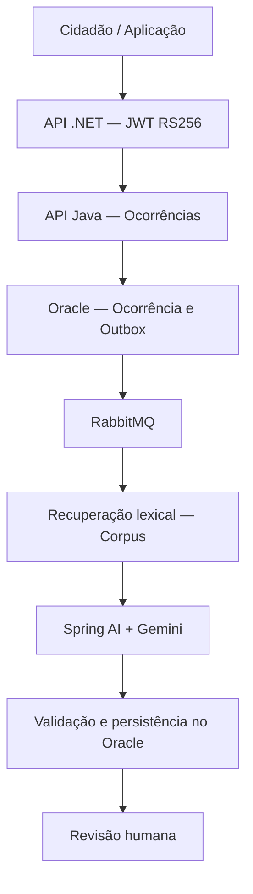

# CityTech — Inteligência Artificial Generativa com RAG

## 1. Objetivo

O CityTech é uma plataforma de zeladoria urbana que permite registrar ocorrências relacionadas à infraestrutura das cidades.

O módulo de IA auxilia na triagem dessas ocorrências, sugerindo categoria, prioridade, resumo e justificativa. A classificação é uma recomendação: a decisão final permanece com um gestor humano.

Projeto desenvolvido para a Global Solution FIAP 2026/2 — CitizenTech.

## 2. Tecnologias utilizadas

- Java 21 e Spring Boot 4.1.2
- Spring AI 2.0.2
- Google Gemini 3.1 Flash Lite
- RAG básico com recuperação lexical
- RabbitMQ para processamento assíncrono
- Oracle Database 19c para persistência
- API .NET para autenticação JWT RS256

## 3. Arquitetura e funcionamento

O fluxo é integrado à aplicação CityTech, não se tratando de um chatbot genérico.

1. O cidadão autentica-se por meio da API .NET.
2. Registra uma ocorrência na API Java.
3. O Java persiste a ocorrência e um evento na outbox transacional.
4. O publicador envia o evento para o RabbitMQ.
5. O consumidor recupera trechos relevantes do corpus do CityTech.
6. O Spring AI envia a descrição e o contexto recuperado ao Gemini.
7. A resposta é validada e persistida na tabela `AI_SUGGESTIONS`.
8. Um gestor pode aceitar ou rejeitar a recomendação.

## 4. Aprofundamento escolhido: RAG

A solução utiliza Retrieval-Augmented Generation (RAG), combinando a geração de texto do Gemini com regras documentadas no corpus do CityTech.

O corpus fica em `ai/corpus/`, incluindo documentos sobre taxonomia urbana e critérios de prioridade.

A versão atual realiza recuperação lexical de trechos relevantes, incluídos no prompt do modelo. Não utiliza embeddings nem banco vetorial.

Essa abordagem foi escolhida pela simplicidade, reprodutibilidade, baixo custo e possibilidade de verificar as referências utilizadas.

Os critérios do corpus são regras demonstrativas do projeto, não normas oficiais de uma prefeitura.

## 5. Teste integrado realizado

Em 19/11/2026, foi executado um teste real utilizando Java, Oracle da FIAP, RabbitMQ e a API Gemini.

**Entrada:** ocorrência fictícia sobre um buraco profundo em via pública, próximo a uma faixa de pedestres, com risco de acidentes.

**Resultados observados:**

| Campo | Resultado |
|---|---|
| Status da sugestão | PRONTA |
| Modelo | gemini-3.1-flash-lite |
| Categoria sugerida | VIAS |
| Prioridade inicial da ocorrência | MEDIA |
| Prioridade sugerida | ALTA |
| Versão do prompt | rag-v1 |
| Fonte registrada | citytech-corpus/prioridade.md#alta |
| Erro registrado | NULL |

A justificativa da IA fez referência ao risco de acidentes e ao impacto sobre pedestres e veículos.

O documento `prioridade.md` contém o critério ALTA, que contempla risco relevante de acidente, interrupção importante de acesso ou impacto em várias pessoas.

A execução comprova a integração funcional em um caso real de teste, mas não constitui uma medição estatística da precisão do modelo.

Também foi observado um caso de fallback com status `FALHOU` e código `MODEL_NOT_CONFIGURED`, antes da ativação correta do modelo.

## 6. Segurança e uso responsável

- A chave Gemini deve ser fornecida por variável de ambiente, nunca armazenada no GitHub.
- Tokens JWT, credenciais de bancos e senhas não devem ser publicados.
- Os exemplos acadêmicos utilizam ocorrências fictícias.
- As sugestões da IA estão sujeitas à revisão humana.
- O sistema deve registrar falhas explicitamente, sem inventar classificações.
- A IA não substitui a avaliação de risco realizada por profissionais responsáveis.

## 7. Execução e reprodução

Pré-requisitos: Java 21, Oracle com schema e categorias cadastradas, RabbitMQ funcionando e chaves JWT compatíveis com o backend .NET.

Configurar no ambiente do Java:

- `ORACLE_JDBC_URL`
- `ORACLE_USERNAME`
- `ORACLE_PASSWORD`
- `RABBITMQ_USER`
- `RABBITMQ_PASSWORD`
- `JWT_PUBLIC_KEY_PATH`
- `GEMINI_API_KEY`
- `SPRING_AI_MODEL_CHAT=google-genai`
- `AI_CHAT_MODEL=gemini-3.1-flash-lite`
- `OUTBOX_PUBLISHER_ENABLED=true`

Dentro de `backend-java`, executar `.\mvnw.cmd test` para validar a suíte e `.\mvnw.cmd spring-boot:run` para iniciar a aplicação.

O backend Java disponibiliza o Swagger em `http://localhost:8080/swagger-ui.html`.

O backend .NET deve emitir o JWT utilizado nas chamadas autenticadas. A criação de uma ocorrência dispara a cadeia assíncrona, cujo resultado pode ser consultado na API e no Oracle.

Consulte também os READMEs de `backend-java/` e `backend-dotnet/`.

## 8. Avaliação e limitações

**Comprovado até o momento:** um caso de inferência real com classificação persistida e um caso anterior de fallback por ausência de modelo.

Ainda é necessário avaliar uma amostra maior, incluindo diferentes categorias, prioridades, casos ambíguos, descrições incompletas e falhas de provedor.

Critérios previstos para avaliação:

- Acurácia da categoria em relação ao rótulo humano.
- Coerência da prioridade sugerida.
- Fidelidade do resumo à ocorrência original.
- Relevância das fontes recuperadas.
- Conformidade da resposta com o formato esperado.
- Taxa de falhas e comportamento de fallback.

As limitações atuais incluem recuperação lexical sem embeddings, corpus pequeno, dependência da disponibilidade da API Gemini e possibilidade de classificações incorretas ou justificativas imprecisas.

Os casos e resultados adicionais devem ser documentados em [evaluation/](evaluation/README.md), sem atribuir métricas não medidas ao modelo.

## 9. Referências internas

- [Corpus de referência](corpus/README.md)
- [Plano de avaliação](evaluation/README.md)
- [Backend Java](../backend-java/README.md)
- [Arquitetura do CityTech](../docs/arquitetura.md)
- [Contratos de integração](../docs/contratos-api.md)

## 10. Entrega acadêmica

A disciplina de IA Generativa exige o repositório no GitHub, com código, README, documentação e evidências, e a entrega de um arquivo `.txt` contendo nome completo, RM dos integrantes e endereço do repositório.

Repositório: https://github.com/ThiagoSpositoo/GlobalSolution-CityTech

O projeto utilizou ferramentas de IA no apoio ao desenvolvimento e integra o Gemini como funcionalidade do produto. As implementações, testes e conclusões devem ser revisados pelos integrantes do grupo.