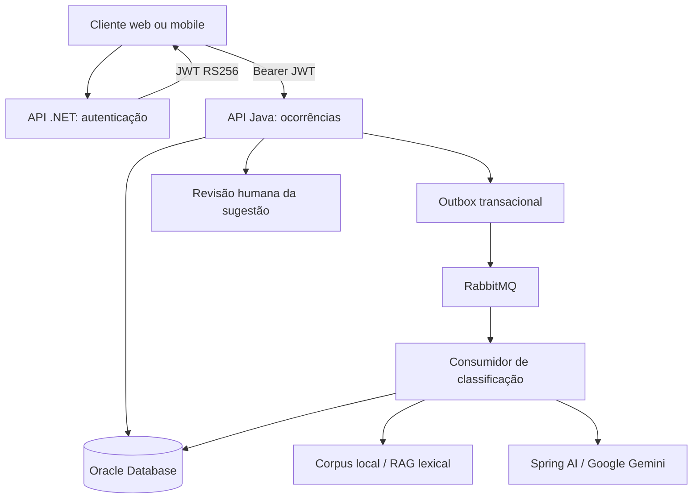

# CityTech — Backend Java | Global Solution FIAP 2026/2

API de zeladoria urbana desenvolvida com **Java 21** e **Spring Boot 4.1.2**. O serviço gerencia categorias, ocorrências, histórico de alterações, indicadores e sugestões de classificação por inteligência artificial. Integra-se à autenticação do backend .NET, ao **Oracle Database**, ao **RabbitMQ** e ao **Google Gemini** por meio do **Spring AI**.

## Integrantes

| Integrante | RM |
| --- | --- |
| Thiago Sposito | 561694 |
| Vitor Madrigrano | 564191 |
| Lucas Lopes | 563544 |

**Turmas:** 2TDSA / 2TDSR  
**Projeto:** CityTech — Global Solution 2026/2  
**Repositório:** https://github.com/ThiagoSpositoo/GlobalSolution-CityTech

## Funcionalidades implementadas

- API REST com operações de cadastro, consulta, atualização e exclusão lógica de ocorrências; gerenciamento e paginação de categorias.
- Entidades relacionadas via **Spring Data JPA**, com persistência em Oracle e histórico de alterações.
- Validações com **Bean Validation**, tratamento padronizado de erros e controle de concorrência otimista por versão.
- Autenticação e autorização com **JWT RS256** emitido pelo backend .NET e validado pelo Java, incluindo os papéis `CIDADAO` e `GESTOR`.
- **OpenAPI/Swagger** e endpoints de saúde (*liveness* e *readiness*).
- **Outbox transacional**, publicação e consumo assíncronos de eventos no RabbitMQ, idempotência de consumo e fila de mensagens mortas (DLQ).
- **Spring AI 2.0.2 + Google Gemini**, com recuperação lexical de trechos de um corpus versionado (*RAG básico*) e geração de sugestões revisáveis.
- Testes automatizados, incluindo testes isolados com H2 em modo Oracle; teste de integração real com RabbitMQ disponível mediante configuração.

## Arquitetura



**Fluxo de IA:** o registro da ocorrência gera um evento de forma transacional; um publicador o encaminha ao RabbitMQ; o consumidor recupera trechos relevantes do corpus, consulta o modelo configurado, valida a estrutura da resposta e persiste a sugestão no Oracle. A classificação gerada **não substitui a decisão de um gestor**.

## Tecnologias

| Camada | Tecnologia |
| --- | --- |
| Linguagem | Java 21 |
| API | Spring Boot 4.1.2 / Spring MVC |
| Persistência | Spring Data JPA / Oracle Database |
| Segurança | Spring Security / OAuth2 Resource Server / JWT RS256 |
| Mensageria | Spring AMQP / RabbitMQ |
| IA generativa | Spring AI 2.0.2 / Google Gemini |
| Recuperação de contexto | RAG lexical sobre corpus local versionado |
| Documentação | springdoc OpenAPI / Swagger UI |
| Testes | Maven, testes Spring e H2 em modo Oracle |

## Rotas e documentação

Ao iniciar o backend na porta padrão **8080**:

- Swagger UI: `http://localhost:8080/swagger-ui.html`
- Especificação OpenAPI: `http://localhost:8080/v3/api-docs`
- Liveness: `http://localhost:8080/health/live`
- Readiness: `http://localhost:8080/health/ready`

Rotas principais sob `/api/v1`:

- `/categories` — categorias cadastradas, operações CRUD e paginação.
- `/occurrences` — ocorrências urbanas, consulta, cadastro e atualização.
- `/occurrences/{id}/history` — histórico da ocorrência.
- `/occurrences/{id}/ai-suggestion/review` — análise humana da sugestão de IA.
- `/manager/indicators` — indicadores para gestores.

As permissões variam conforme o papel e a titularidade da ocorrência. Atualizações utilizam `version` para controle de concorrência; um conflito pode resultar em `409 CONCURRENT_MODIFICATION`.

## Pré-requisitos

1. **JDK 21** instalado.
2. **Oracle** acessível, com o schema do CityTech previamente instalado.
3. **RabbitMQ** disponível e configurado.
4. Chave **pública RSA** correspondente à chave privada usada pelo backend .NET para emitir JWT.
5. Para executar a classificação generativa, chave de API do **Google Gemini** com acesso ao modelo configurado.

O repositório inclui o **Maven Wrapper**: não é necessário instalar Maven globalmente.

### Variáveis de ambiente

Configuração do Java (PowerShell; valores apenas ilustrativos):

```powershell
$env:ORACLE_JDBC_URL = "jdbc:oracle:thin:@//HOST:1521/SERVICO"
$env:ORACLE_USERNAME = "USUARIO_ORACLE"
$env:ORACLE_PASSWORD = "SENHA_ORACLE"
$env:JWT_PUBLIC_KEY_PATH = "C:\\caminho\\jwt-public.pem"
$env:RABBITMQ_USER = "USUARIO_RABBITMQ"
$env:RABBITMQ_PASSWORD = "SENHA_RABBITMQ"
$env:SPRING_PROFILES_ACTIVE = "local"
$env:SPRING_AI_MODEL_CHAT = "google-genai"
$env:AI_CHAT_MODEL = "gemini-3.1-flash-lite"
$env:GEMINI_API_KEY = "CHAVE_GEMINI"
$env:OUTBOX_PUBLISHER_ENABLED = "true"
```

Os valores acima são *placeholders*; substitua-os por configurações válidas **somente no ambiente local**. O Java não lê automaticamente o arquivo `.env` ao ser iniciado diretamente pelo Maven. Nunca publique senhas, tokens JWT, chaves de API ou a chave RSA privada.

Variáveis adicionais podem incluir `JWT_ISSUER`, `JWT_AUDIENCE`, `JWT_KEY_ID`, `JAVA_SERVER_PORT`, `RABBITMQ_HOST`, `RABBITMQ_PORT`, `OUTBOX_PUBLISHER_DELAY_MS` e `CORS_ALLOWED_ORIGINS` (esta última no perfil local).

### Schema Oracle

O esquema e os scripts ficam em [`../database/oracle/`](../database/oracle/). O backend utiliza `spring.jpa.hibernate.ddl-auto=validate`, portanto **não cria nem altera o esquema automaticamente**.

A aplicação foi conectada ao Oracle institucional da FIAP durante os testes, com tabelas e categorias do projeto. Há também validação documentada em Oracle XE local. Isso **não equivale a afirmar que todos os scripts PL/SQL foram reexecutados na instância institucional**.

## Execução no Windows

Na pasta `backend-java/`, com os serviços e variáveis configurados:

```powershell
.\mvnw.cmd test
.\mvnw.cmd package
.\mvnw.cmd spring-boot:run
```

O comando `test` executa a suíte automatizada; `package` compila e gera um JAR na pasta `target/`; `spring-boot:run` inicia a aplicação. Execute um comando por vez para facilitar a identificação de problemas.

Para Linux/macOS, há também o script [`run-local.sh`](run-local.sh), que carrega as configurações locais conforme descrito no projeto.

## Mensageria e resiliência

Ao criar uma ocorrência, o backend registra os dados e a **outbox** na mesma transação. O publicador encaminha o evento `OccurrenceCreated.v1` ao exchange `citytech.occurrences`; um consumidor lê a fila `citytech.ai.classification.v1` e deduplica por `eventId`.

O fluxo possui tratamento de erros, tentativas de consumo e DLQ. Caso o modelo não esteja configurado, a falha é registrada explicitamente com o código `MODEL_NOT_CONFIGURED`, sem criar uma falsa classificação de IA.

## Integração de IA generativa e RAG

A integração utiliza **Spring AI** com o provedor **Google Gemini** e o modelo testado `gemini-3.1-flash-lite`. O corpus canônico está em [`../ai/corpus/`](../ai/corpus/) e é incluído como recurso do JAR pelo Maven. A recuperação é **lexical**, não vetorial: não se deve confundi-la com busca por embeddings.

**Evidência observada em execução local:**

- Ocorrência fictícia: buraco profundo em via pública.
- Pipeline: publicação assíncrona, consumo do evento e chamada real ao Gemini.
- Categoria sugerida: `VIAS`.
- Prioridade sugerida: `ALTA`.
- Justificativa: risco de acidente para pedestres e usuários da via.
- Fonte recuperada: `citytech-corpus/prioridade.md#alta`.
- Versão do prompt: `rag-v1`.
- Resultado persistido no Oracle: status `PRONTA`, sem código de erro.

Também foi observado um cenário anterior com `MODEL_NOT_CONFIGURED`, demonstrando tratamento de indisponibilidade de modelo. Esses são **cenários de demonstração**, e não uma avaliação estatística de acurácia. Para metodologia e limitações, consulte [`../ai/evaluation/README.md`](../ai/evaluation/README.md).

A sugestão de IA é revisável: um gestor pode aceitá-la ou rejeitá-la conforme as regras da aplicação.

## Testes e validações

- A suíte Maven foi executada com **`BUILD SUCCESS`** após a correção do `pom.xml` (19/11/2026).
- Os testes utilizam isolamento de serviços, incluindo **H2 em modo Oracle** quando apropriado.
- Um teste AMQP de integração pode ser ativado com um RabbitMQ real configurado:

```powershell
$env:CITYTECH_RUN_RABBIT_INTEGRATION = "true"
.\mvnw.cmd -Dtest=RabbitIntegrationTests test
```

- A interoperabilidade de autenticação foi verificada: um token JWT emitido pelo backend .NET foi aceito pela API Java em uma chamada autenticada.
- A inferência real com Gemini foi observada e persistida em banco, conforme a seção anterior.

**Limitações:** o fluxo completo de criação de acompanhamentos pela API .NET não foi integralmente validado ponta a ponta; os testes acadêmicos de IA ainda cobrem poucos casos; e a disponibilização do frontend/mobile não está comprovada aqui. Não foram calculadas métricas de acurácia, latência média ou recall do modelo.

## Segurança, limites e reprodução

- Credenciais e chaves privadas ficam fora do controle de versão.
- O Java valida tokens RS256, incluindo emissor, audiência, expiração e permissões esperadas.
- O acesso a operações protegidas exige JWT válido.
- A recuperação RAG usa um corpus versionado para que as fontes possam ser verificadas.
- Resultados de IA podem conter erros; a decisão final e a avaliação de risco permanecem sob responsabilidade humana.
- A disponibilidade do Oracle, do RabbitMQ e do provedor Gemini é necessária para reproduzir a demonstração completa.

## Estrutura do repositório e materiais de apoio

- [`../backend-dotnet/`](../backend-dotnet/) — autenticação e acompanhamento de ocorrências.
- [`../ai/README.md`](../ai/README.md) — detalhamento do módulo generativo.
- [`../ai/corpus/`](../ai/corpus/) — documentos de recuperação de contexto.
- [`../ai/evaluation/`](../ai/evaluation/) — avaliação e limitações da IA.
- [`../database/oracle/`](../database/oracle/) — scripts do banco de dados.
- [`../docs/arquitetura.md`](../docs/arquitetura.md) — arquitetura geral.
- [`../docs/contratos-api.md`](../docs/contratos-api.md) — contratos de integração.

## Entrega acadêmica

Repositório: https://github.com/ThiagoSpositoo/GlobalSolution-CityTech  
Backend Java: https://github.com/ThiagoSpositoo/GlobalSolution-CityTech/tree/main/backend-java

O pacote acadêmico deve incluir a identificação dos integrantes e o **link para o vídeo de apresentação (até 5 minutos)**, conforme as instruções da disciplina. Adicionar o endereço real do pitch somente depois de gravá-lo e publicá-lo.
