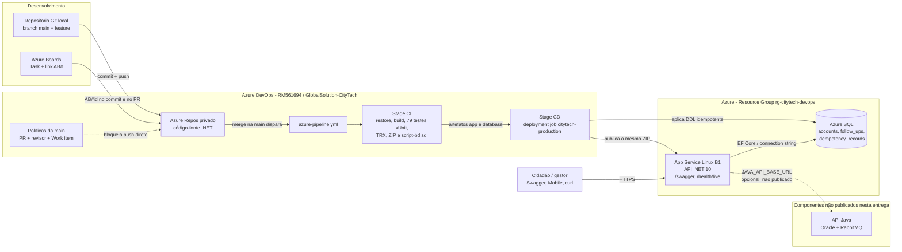

# DevOps — CityTech na Azure (App Service + Azure SQL + Azure Pipelines)

Disciplina **DevOps Tools & Cloud Computing** — Global Solution FIAP 2026/2.
Organização Azure DevOps: <https://dev.azure.com/RM561694> · Projeto: `GlobalSolution-CityTech`.

> **Regra deste documento:** só é marcado **COMPROVADO** o que foi executado e verificado.
> Código pronto e não executado na Azure é **PREPARADO**. O que ainda falta é **PENDENTE**.
> A execução externa (login, provisionamento, push, pipeline) depende de autorização do grupo.

---

## 1. Situação real dos requisitos

| # | Requisito | Estado | Evidência / o que falta |
|---|---|---|---|
| DEV-01 | Solução Java **ou** .NET na nuvem com Boards, Repos e Pipelines | PENDENTE | Código escolhido e preparado; nenhum recurso Azure criado |
| DEV-02 | Provisionamento por scripts Azure CLI usados pelo build/release | PREPARADO | `scripts/provision-azure.ps1` e `scripts/provision-azure.sh` validados localmente (dry-run) |
| DEV-03 | Projeto Azure DevOps; professor Basic + Project Administrators | PENDENTE | Projeto existe; permissões do professor não concedidas nem verificadas |
| DEV-04 | Repositório privado com código no Azure Repos | PENDENTE | Repositório local pronto; push para o Azure Repos não executado |
| DEV-05 | Tarefa no Boards vinculada a commits/branch/PR | PENDENTE | Roteiro e comandos prontos |
| DEV-06 | Main protegida: revisor obrigatório, Work Item e revisor padrão | PREPARADO | Comandos de política prontos; aplicação depende de acesso ao projeto |
| DEV-07 | CI automática na main após merge por PR | PREPARADO | `azure-pipeline.yml` validado; nunca executado no Azure Pipelines |
| DEV-08 | Testes automáticos e artefatos publicados | PREPARADO | 79 testes passam localmente; publicação de TRX/ZIP na CI não executada |
| DEV-09 | Release/deploy automático após artefato da CI | PREPARADO | Stage CD dependente da CI; sem execução real |
| DEV-10 | App Service (ou container) | PREPARADO | App Service Linux B1 no script de provisionamento |
| DEV-11 | Banco PaaS na nuvem (Azure SQL) | PREPARADO | Azure SQL Basic no script; nenhum servidor criado |
| DEV-12 | Scripts de infraestrutura em `/scripts` | COMPROVADO (arquivos) | Scripts versionados, parser validado; execução real pendente |
| DEV-13 | `/scripts/script-bd.sql` com DDL | COMPROVADO (arquivo) | Gerado por `dotnet ef migrations script --idempotent` (6.058 bytes) |
| DEV-14 | Dockerfiles se containerizar | N/A | Solução avaliada usa runtime nativo do App Service (sem container) |
| DEV-15 | `azure-pipeline.yml` na raiz | COMPROVADO (arquivo) | YAML na raiz, validado |
| DEV-16 | CRUD JSON no README / JSON por tabela | COMPROVADO (arquivos) | `scripts/crud/accounts.json` e `scripts/crud/followups.json` + Swagger |
| DEV-17 | Variáveis de ambiente nas pipelines, sem senha exposta | PREPARADO | Variable group `citytech-prod` + segredos no App Service |
| DEV-18 | Desenho macro com fluxo e legenda | COMPROVADO | `docs/diagramas/devops-cloud.mmd` e seção 3 abaixo |
| DEV-20 | ≥2 tabelas com CRUD e persistência na nuvem | PREPARADO | `accounts` e `follow_ups`; roteiro SQL/HTTP na seção 8 |
| DEV-V01…V08 | Vídeo 720p narrado, contínuo, com todos os itens | PREPARADO | Vídeo publicado: <https://youtu.be/ZeVsvk4luIM>; link acessível, conteúdo/resolução devem ser conferidos pelo grupo |

Nada acima foi executado na Azure nesta sessão: o ambiente não possui `az login`, PAT do Azure DevOps
nem autorização para criar recursos pagos.

---

## 2. Backend escolhido e justificativa

**API .NET 10 (`backend-dotnet`) em App Service Linux + Azure SQL.**

| Critério | .NET | Java |
|---|---|---|
| Banco na nuvem | SQL Server → **Azure SQL** (mesmo dialeto, migrations EF Core) | Oracle; Azure não oferece Oracle gerenciado barato |
| Dependências para subir | Nenhuma além do banco (emite o próprio JWT RS256) | Oracle + RabbitMQ + chave pública do .NET |
| Testes automatizados | **79 testes** (domínio, integração com SQL Server real, API) | 42 testes (41 padrão + 1 AMQP opt-in) |
| Custo mensal estimado | ~US$ 18 (B1 + SQL Basic) | precisaria de Oracle + broker + segundo App Service |
| Risco de falhar no deploy hoje | Baixo | Alto (Oracle/RabbitMQ externos) |

O Java continua sendo o dono das ocorrências e o `.NET` o dono de contas/acompanhamentos. Como o Java
não é publicado nesta entrega, `POST /api/v1/followups` e `/health/ready` retornam **503** na nuvem —
comportamento já previsto e testado no código (não é falha do deploy). O CRUD de `follow_ups` é
demonstrado por SQL direto no Azure SQL (exigência da página 48 do enunciado) e por
`GET/PATCH/DELETE` da API, que não dependem do Java.

---

## 3. Arquitetura macro da entrega DevOps

Fonte editável: [`../docs/diagramas/devops-cloud.mmd`](../docs/diagramas/devops-cloud.mmd).



**Legenda:** verde = recursos Azure criados por script; azul = componentes do Azure DevOps;
laranja tracejado = componente do projeto que **não** é publicado nesta entrega.
Fluxo: commit → PR → merge na `main` → CI (build/testes/artefatos) → CD (DDL no Azure SQL → ZIP no App Service) → validação HTTPS.

---

## 4. Pré-requisitos e custo

| Item | Valor |
|---|---|
| Azure CLI | 2.93.0 instalado (`az version`) — **sem login nesta sessão** |
| .NET SDK | 10.0.404 (validado: build 0 avisos/0 erros, 79 testes) |
| App Service Linux B1 | ~US$ 13/mês |
| Azure SQL Basic (5 DTU, 2 GB) | ~US$ 5/mês |
| **Total aproximado** | **~US$ 18/mês** enquanto os recursos existirem |
| Região sugerida | `brazilsouth` (menor latência no Brasil); `eastus2` costuma ser mais barato |

Cobrança é recorrente até excluir o Resource Group. O script **não** exclui nada.

---

## 5. Passo 1 — Provisionar a infraestrutura

Pasta de execução: raiz do repositório (`C:\Users\sposi\OneDrive\Documents\GlobalSolution-CityTech`).

### 5.1 Login e assinatura

```powershell
az login
az account list --query "[].{Nome:name, Id:id, Estado:state}" --output table
```

**Esperado:** navegador abre, login concluído e a assinatura aparece como `Enabled`.
**Se falhar:** `az login --use-device-code` e confirme no navegador; verifique se a conta tem permissão de Contributor.

### 5.2 Configuração local (não versionada)

```powershell
Copy-Item .\scripts\azure-config.example.json .\scripts\azure-config.local.json
notepad .\scripts\azure-config.local.json
```

Preencha `subscriptionId` (do passo anterior), `webAppName` e `sqlServerName` com nomes **globalmente únicos**
(ex.: `citytech-api-rm561694`, `citytech-sql-rm561694`), `sqlAdminPassword` forte (12+ caracteres, maiúscula,
minúscula, número e símbolo) e mantenha `jwtPrivateKeyPath`/`jwtPublicKeyPath` apontando para o par RSA local
já existente em `C:\Users\sposi\.citytech\keys\` (`jwt-private.pem` e `jwt-public.pem`, fora do repositório).

**Verifique que o arquivo não será commitado:**

```powershell
git check-ignore -v .\scripts\azure-config.local.json
```

**Esperado:** uma linha citando `.gitignore` com `azure-config.local.json`.

### 5.3 Dry-run (não cria nada)

```powershell
powershell.exe -NoProfile -ExecutionPolicy Bypass -File .\scripts\provision-azure.ps1 -ConfigPath .\scripts\azure-config.local.json
```

**Esperado:** tabela com assinatura, grupo, região, plano B1, App Service, SQL Basic, custo estimado e a frase
`DRY-RUN: nada foi criado`. **Se falhar:** leia a mensagem — normalmente é campo vazio no JSON, chave PEM
ausente ou `az` fora do PATH.

### 5.4 Provisionamento real (cria recursos pagos)

Somente depois de revisar nomes/custos e com autorização do grupo:

```powershell
powershell.exe -NoProfile -ExecutionPolicy Bypass -File .\scripts\provision-azure.ps1 -ConfigPath .\scripts\azure-config.local.json -Approved
```

**Esperado:** mensagens `criado/garantido` para Resource Group, plano, SQL Server, firewall, banco e App Service,
seguidas da tabela de recursos e de `URL prevista: https://<webAppName>.azurewebsites.net`.
**Se falhar:** `az group show -n <grupo>` confirma se o grupo existe; nomes já usados retornam erro de conflito
(troque `webAppName`/`sqlServerName`); falta de permissão retorna `AuthorizationFailed` (peça Contributor ao dono da assinatura).

**Verificação independente:**

```powershell
az resource list --resource-group rg-citytech-devops --query "[].{Nome:name, Tipo:type, Local:location}" --output table
az sql db show --resource-group rg-citytech-devops --server <sqlServerName> --name citytechdb --query "{nome:name, sku:currentServiceObjectiveName, status:status}" --output table
```

**Esperado:** App Service + plano + servidor SQL + banco `Online` com SKU `Basic`.

> O App Service ainda **não** tem código nesta etapa: a URL responde 503 até a primeira execução da pipeline.

### 5.5 Retomar depois de uma falha parcial

O script pode ser executado quantas vezes for necessário: cada recurso é consultado antes de ser criado,
o que já existe é preservado e nada é excluído. Basta repetir o **mesmo comando**:

```powershell
powershell.exe -NoProfile -ExecutionPolicy Bypass -File .\scripts\provision-azure.ps1 -ConfigPath .\scripts\azure-config.local.json -Approved
```

**Como o script classifica as respostas do Azure:**

| Resposta | Significado | Ação do script |
|---|---|---|
| `exit 0` | recurso existe | preserva |
| `ResourceGroupNotFound` (na checagem do grupo) | grupo ainda não existe | cria o grupo |
| `ResourceNotFound` / `ParentResourceNotFound` / `exit 3` | recurso ainda não existe | cria o recurso |
| `Please run 'az login'` | sessão expirada | para e pede `az login` |
| `AuthorizationFailed` / `InsufficientPermissions` | falta permissão | para com a mensagem do Azure |
| `SubscriptionNotFound` | assinatura errada ou sem acesso | para e aponta o campo `subscriptionId` |
| `SkuNotAvailable` / `QuotaExceeded` / `RequestDisallowedByPolicy` | restrição real da assinatura/região | para com a mensagem do Azure |
| Qualquer outra | inesperado | para e exibe a saída completa |

Ou seja: "não encontrado" nunca é confundido com falha de permissão, e falha real nunca é tratada como
"recurso inexistente".

**Diagnóstico somente leitura** (não cria nada):

```powershell
az account show --query "{conta:user.name, assinatura:name, id:id, estado:state}" --output json
az group show --name rg-citytech-devops --query "{nome:name, local:location, estado:properties.provisioningState}" --output json
az resource list --resource-group rg-citytech-devops --query "[].{nome:name, tipo:type}" --output table
```

**Testes locais do provisionamento, sem tocar no Azure:**

```powershell
powershell.exe -NoProfile -ExecutionPolicy Bypass -File .\scripts\tests\Invoke-ProvisionAzureMockTests.ps1
```

Executa 13 cenários contra um `az` simulado (nada existe, tudo existe, retomada parcial, aviso em stderr,
`AuthorizationFailed`, sem login, grupo ausente em recurso filho, dry-run, assinatura inexistente,
firewall divergente, login admin divergente).

---

## 6. Passo 2 — Azure DevOps (Repos, Boards, políticas, pipeline)

O projeto `GlobalSolution-CityTech` já existe com 5 Epics, 12 Features e 39 PBIs (inventário QA de 19/11).
**Não recrie o projeto.**

### 6.1 Extensão e login do Azure DevOps

```powershell
az extension add --name azure-devops
az devops configure --defaults organization=https://dev.azure.com/RM561694 project=GlobalSolution-CityTech
az devops project list --output table
```

**Esperado:** o projeto aparece na lista. **Se falhar:** crie um PAT em *User settings → Personal access tokens*
com escopos `Code (read/write)`, `Build (read/execute)`, `Work items (read/write)`, `Project and team (read/write)`
e rode `az devops login` (cole o token quando pedir). **Nunca** grave o PAT em arquivo do repositório.

### 6.2 Repositório e primeiro push

```powershell
az repos create --name GlobalSolution-CityTech --project GlobalSolution-CityTech --output table
git remote add azure https://RM561694@dev.azure.com/RM561694/GlobalSolution-CityTech/_git/GlobalSolution-CityTech
git remote -v
git push azure main
```

**Esperado:** `main` publicada no Azure Repos; `git remote -v` mostra `azure` e `origin` (GitHub).
**Se falhar:** se o remoto já existir, use `git remote set-url azure <url>`; autentique com PAT quando solicitado.
Não use `--force`.

> Faça este push **antes** de ativar as políticas da branch, porque a `main` protegida bloqueia push direto.

### 6.3 Políticas da main

```powershell
$repoId = az repos show --repository GlobalSolution-CityTech --project GlobalSolution-CityTech --query id -o tsv

# 1) PR obrigatório com pelo menos 1 revisor (bloqueia push direto na main)
az repos policy approver-count create --repository-id $repoId --branch main `
  --minimum-approver-count 1 --creator-vote-counts false --reset-on-source-push true `
  --blocking true --enabled true

# 2) Work Item vinculado obrigatório
az repos policy work-item-linking create --repository-id $repoId --branch main `
  --blocking true --enabled true

# 3) Comentários resolvidos (opcional, recomendado)
az repos policy comment-required create --repository-id $repoId --branch main `
  --blocking true --enabled true
```

**Esperado:** `az repos policy list --repository-id $repoId --branch main --output table` lista as políticas ativas.

**Revisor padrão (exigência da disciplina):** a política de revisor nomeado precisa do **e-mail institucional
do professor**, que o grupo ainda não informou. Quando tiver o e-mail:

```powershell
# Descubra o identityId do professor na organização
az devops user list --query "[].{email:user.mailAddress, id:originId, nome:displayName}" --output table

az repos policy required-reviewer create --repository-id $repoId --branch main `
  --message "Revisor padrão - DevOps FIAP" `
  --required-reviewer-ids <EMAIL_DO_PROFESSOR> `
  --blocking true --enabled true
```

> Enquanto o e-mail não for confirmado, o requisito **permanece PENDENTE**. Não marque como concluído.

### 6.4 Acesso do professor (Basic + Project Administrators)

No Portal do Azure DevOps: **Organization settings → Users → Add users** → e-mail do professor, licença
**Basic**, e em **Project settings → Permissions → Project Administrators → Members** adicione o usuário.

Verificação (somente leitura, quando o convite existir):

```powershell
az devops user list --output table
az devops security group membership list --id "[GlobalSolution-CityTech]\Project Administrators" --output table
```

**Esperado:** o e-mail do professor aparece nos dois resultados. Sem convite aceito, não aparece — e o requisito continua PENDENTE.

### 6.5 Tarefa no Boards (usada no vídeo)

```powershell
az boards work-item create --title "Expor versao publicada da API .NET" --type Task `
  --description "Adicionar GET /api/v1/version para comprovar a alteracao publicada pelo CD." `
  --output table
```

Anote o **ID** retornado (ex.: 82). Ele será usado como `AB#82` no commit e no PR.

### 6.6 Service connection e variable group

**Service connection (Portal, caminho mais seguro):** *Project settings → Service connections → New service connection
→ Azure Resource Manager → Workload identity federation (automatic)*, escopo na assinatura ou no Resource Group
`rg-citytech-devops`, nome **`citytech-azure`** e marque *Grant access permission to all pipelines*.

**Variable group `citytech-prod`** (*Pipelines → Library*), com acesso liberado à pipeline:

| Variável | Valor | Secreta |
|---|---|---|
| `azureServiceConnection` | `citytech-azure` | não |
| `webAppName` | nome do App Service | não |
| `sqlServerName` | nome do servidor SQL | não |
| `sqlDatabaseName` | `citytechdb` | não |
| `sqlAdminUser` | usuário administrador do SQL | não |
| `sqlAdminPassword` | senha do administrador do SQL | **sim** |

Cadastre a senha pela interface (não por linha de comando) para não deixá-la no histórico do PowerShell.

### 6.7 Criar a pipeline

```powershell
az pipelines create --name "CityTech-CI-CD" --repository GlobalSolution-CityTech `
  --repository-type tfsgit --branch main --yml-path azure-pipeline.yml --skip-first-run true
```

**Esperado:** pipeline criada apontando para `azure-pipeline.yml` na raiz.
**Se falhar:** confirme que o arquivo existe na `main` do Azure Repos (`az repos show` + navegador) e que a
service connection tem permissão.

---

## 7. Passo 3 — Executar e validar CI/CD

```powershell
az pipelines run --name "CityTech-CI-CD" --branch main
az pipelines runs list --pipeline-ids <ID_DA_PIPELINE> --top 5 --output table
```

**Esperado no stage CI:** SQL Server efêmero sobe, `79` testes passam, `PublishTestResults` mostra o TRX,
artefatos `app` (citytech-api.zip) e `database` (script-bd.sql) publicados.
**Esperado no stage CD:** DDL aplicado no Azure SQL, ZIP publicado no App Service e log
`Aplicacao respondendo em https://...` na etapa de validação.

Validação independente:

```powershell
$app = "https://<webAppName>.azurewebsites.net"
Invoke-RestMethod "$app/" | ConvertTo-Json
Invoke-RestMethod "$app/health/live"
Start-Process "$app/swagger"
```

**Esperado:** `service = CityTech.Api`, `status = ok`, liveness `Healthy` e Swagger aberto no navegador.
**Se falhar:** *Deployment Center → Logs* mostra o startup; causa comum é variável `DOTNET_DB_CONNECTION`
ausente/inválida ou chave JWT não configurada.

> `GET /health/ready` retorna **503** de propósito enquanto o Java não estiver publicado (dependência real).

---

## 8. Passo 4 — CRUD e SELECT no banco em nuvem

### 8.1 Pela API (evidência HTTP)

```powershell
powershell.exe -NoProfile -ExecutionPolicy Bypass -File .\scripts\demo-crud-cloud.ps1 `
  -BaseUrl https://<webAppName>.azurewebsites.net
```

O script executa cadastro (CREATE em `accounts`), login, `/auth/me` (READ), listagem de acompanhamentos e,
quando há acompanhamento, PATCH e DELETE. Cada chamada imprime método, rota e status.

### 8.2 Direto no Azure SQL (exigência do enunciado: SELECT, não apenas GET)

Portal do Azure → **SQL database `citytechdb` → Query editor (preview)** → autentique com o usuário administrador.

```sql
-- READ: estrutura criada pelo CD
SELECT TABLE_NAME FROM INFORMATION_SCHEMA.TABLES WHERE TABLE_TYPE = 'BASE TABLE' ORDER BY TABLE_NAME;
SELECT MigrationId FROM __EFMigrationsHistory;

-- READ: contas criadas pela API
SELECT id, name, email, role, active, version, created_at FROM accounts ORDER BY created_at DESC;

-- UPDATE em accounts (a API .NET não expõe PUT/DELETE de conta)
UPDATE accounts
   SET name = N'Cidadão Demonstração Atualizado',
       updated_at = SYSUTCDATETIME(),
       version = version + 1
 WHERE email_normalized = N'cidadao.demo@citytech.local';

-- CREATE em follow_ups (quando o Java não está publicado)
DECLARE @userId uniqueidentifier =
    (SELECT id FROM accounts WHERE email_normalized = N'cidadao.demo@citytech.local');
INSERT INTO follow_ups (id, user_id, occurrence_id, note, created_at, updated_at, version)
VALUES (NEWID(), @userId, NEWID(), N'Acompanhamento criado via SQL para evidência DevOps',
        SYSUTCDATETIME(), SYSUTCDATETIME(), 0);

-- READ com JOIN entre as duas tabelas (prova a relação)
SELECT f.id, a.email, f.occurrence_id, f.note, f.version, f.created_at
  FROM follow_ups f
  INNER JOIN accounts a ON a.id = f.user_id
 ORDER BY f.created_at DESC;

-- UPDATE e DELETE em follow_ups
UPDATE follow_ups SET note = N'Observação atualizada via SQL', updated_at = SYSUTCDATETIME(), version = version + 1
 WHERE id = (SELECT TOP 1 id FROM follow_ups ORDER BY created_at DESC);

DELETE FROM follow_ups WHERE id = (SELECT TOP 1 id FROM follow_ups ORDER BY created_at DESC);

-- DELETE da conta fictícia (a FK remove os acompanhamentos em cascata)
DELETE FROM accounts WHERE email_normalized = N'cidadao.demo@citytech.local';
```

Use **conta e ocorrência fictícias**. Não execute `DROP`, `TRUNCATE` nem apague dados de outros usuários.

---

## 9. Passo 5 — Tarefa → branch → PR → merge (roteiro do vídeo)

Alteração real escolhida: **novo endpoint `GET /api/v1/version`** (comprova que o CD publicou o código novo).

```powershell
$taskId = <ID_DA_TASK>
git checkout main
git pull azure main
git checkout -b feature/version-endpoint

# Edite backend-dotnet/src/CityTech.Api/Program.cs e adicione, antes de app.Run():
#   app.MapGet("/api/v1/version", (IWebHostEnvironment env) => Results.Ok(new
#   {
#       service = "CityTech.Api",
#       version = "1.1.0",
#       environment = env.EnvironmentName
#   })).AllowAnonymous();

git add backend-dotnet/src/CityTech.Api/Program.cs
git commit -m "feat(api): expoe versao publicada da API AB#$taskId"
git push azure feature/version-endpoint

az repos pr create --repository GlobalSolution-CityTech --source-branch feature/version-endpoint `
  --target-branch main --title "Expoe versao publicada da API" `
  --description "AB#$taskId - endpoint /api/v1/version para comprovar o deploy." `
  --work-items $taskId --output table
```

**Esperado:** PR criada e vinculada à task; políticas exigem 1 aprovação e Work Item.
Aprovação e conclusão (o aluno pode aprovar a própria PR nesta simulação):

```powershell
az repos pr set-vote --id <PR_ID> --vote approve
az repos pr update --id <PR_ID> --status completed --squash true
```

**Esperado:** merge na `main` dispara a pipeline automaticamente (trigger da `main`).
Confirme no log do stage CD a linha `Aplicacao respondendo` e abra:

```powershell
Invoke-RestMethod "https://<webAppName>.azurewebsites.net/api/v1/version" | ConvertTo-Json
```

**Esperado:** `version = 1.1.0` — prova de que a alteração da branch está publicada na nuvem.
Por fim, atualize a task para `Done`:

```powershell
az boards work-item update --id $taskId --state Done --output table
```

---

## 10. Verificações locais já executadas (comprovadas)

| Verificação | Resultado |
|---|---|
| `dotnet build CityTech.slnx -c Release` | 0 avisos, 0 erros |
| `dotnet test CityTech.slnx -c Release` | **79/79 aprovados** (77 anteriores + 2 de chave JWT por PEM) |
| `dotnet ef migrations script --idempotent` | gerou `scripts/script-bd.sql` a partir das migrations reais; corpo idêntico ao artefato da CI (SHA-256 `AFF7B9B9…328532E9`) |
| `dotnet tool restore` com `backend-dotnet/.config/dotnet-tools.json` | restaurou `dotnet-ef` 10.0.15 — corrige o `dotnet tool restore` da CI, que antes falharia sem manifesto |
| Simulação local do stage CI (build Release + geração do DDL com SQL Server real) | build 0 avisos/0 erros; DDL gerado com sucesso |
| `bash -n` nos 7 blocos `bash` da pipeline e em `provision-azure.sh` (Git Bash) | sintaxe válida |
| Parser PowerShell (`provision-azure.ps1`, `demo-crud-cloud.ps1`) | sem erro de sintaxe |
| Testes do provisionamento com Azure CLI simulado (`scripts/tests/`) | **48/48 verificações aprovadas** em 13 cenários; nenhum comando real do Azure |
| Consultas reais de existência (somente leitura) | RG `rg-citytech-devops` classificado como existente; plano, servidor SQL, banco e App Service como inexistentes, **sem exceção** |
| `bash -n scripts/provision-azure.sh` | sintaxe válida |
| JSON (`azure-config.example.json`, `scripts/crud/*.json`) | parse válido |
| `azure-pipeline.yml` | estrutura de stages/steps validada |
| `git check-ignore scripts/azure-config.local.json` | ignorado corretamente |

> A execução de testes no caminho do OneDrive foi bloqueada pelo Controle de Aplicativo do Windows
> (`0x800711C7`). A suíte foi executada com sucesso em `%TEMP%\opencode\dotnet-build` (cópia fora do OneDrive).
> O agente de CI Linux não sofre esse bloqueio.

---

## 11. Riscos e limitações reais

1. **Java/Oracle/RabbitMQ não publicados** → `POST /api/v1/followups` e `/health/ready` retornam 503 na nuvem.
2. **Azure SQL Basic** é suficiente para a demonstração, mas tem 5 DTU; não use para carga real.
3. **Segredos**: a connection string e as chaves JWT ficam nas configurações do App Service (criptografadas em repouso).
   O ideal em produção é Key Vault com identidade gerenciada.
4. **Firewall `AllowAzureServices`** é amplo; em produção usar rede privada.
5. **Custo recorrente** de ~US$ 18/mês até excluir o Resource Group.
6. **Revisor padrão** depende do e-mail do professor, ainda não informado.
7. **`script-bd.sql`** é gerado pelas migrations; não deve ser editado à mão nem executado junto de `dotnet ef database update`.

---

## 12. Arquivos desta entrega

| Caminho | Papel |
|---|---|
| `azure-pipeline.yml` | CI/CD real (build, testes, artefatos, Azure SQL, App Service) |
| `scripts/provision-azure.ps1` | Provisionamento Azure CLI para Windows 11/PowerShell 5.1 |
| `scripts/tests/Invoke-ProvisionAzureMockTests.ps1` | Testes do provisionamento contra Azure CLI simulado |
| `scripts/provision-azure.sh` | Equivalente para Bash/WSL/Linux |
| `scripts/azure-config.example.json` | Modelo de configuração (sem segredos) |
| `scripts/script-bd.sql` | DDL idempotente real das migrations EF Core |
| `backend-dotnet/.config/dotnet-tools.json` | Manifesto que fixa `dotnet-ef` 10.0.15 (usado pela CI e pelo desenvolvedor) |
| `scripts/demo-crud-cloud.ps1` | CRUD HTTP da aplicação publicada |
| `scripts/crud/accounts.json`, `scripts/crud/followups.json` | Exemplos JSON de CRUD por tabela |
| `docs/diagramas/devops-cloud.mmd` | Diagrama macro (fonte Mermaid) |
| `devops/roteiro-video.md` | Roteiro de gravação item a item |
| `entregas/CityTech_RM561694.pdf` | PDF de entrega da disciplina |
