# Arquitetura CityTech — decisão inicial

Status: arquitetura-alvo em implementação. As verticais .NET e Java foram implementadas/testadas localmente, o RabbitMQ real foi verificado, o Mobile foi implementado e o schema Oracle foi validado em XE 21 com o backend Java. Oracle institucional, LLM externo e integração positiva entre processos/dispositivo permanecem pendentes. A **Etapa 3B** detalhou backlog, modelo e contratos em [backlog](backlog.md), [modelo de domínio](modelo-dominio.md), [contratos das APIs](contratos-api.md), [integração Mobile](integracao-mobile.md) e [decisões/riscos](decisoes-e-riscos.md).

## 1. Objetivo e limites do produto

Registrar, classificar e acompanhar problemas urbanos: vias, iluminação, acessibilidade, descarte, água e outros. Cidadão: cadastro/login, CRUD de ocorrências próprias, endereço, fotos opcionais, acompanhamento. Gestor: triagem, alteração de status e indicadores administrativos.

Aplicação demonstrativa com dados fictícios e sem vínculo oficial com prefeitura. Cores propostas: azul `#145DA0`, branco `#FFFFFF`, verde `#16845B`; validar contraste nas combinações finais. Não depender exclusivamente de cor para informar status. Tipografia, imagens e ícones próprios/licenciados serão definidos no Mobile.

ODS principal: 11, especialmente contribuição proposta às metas 11.3 (gestão participativa) e 11.7 (espaços públicos acessíveis). São relações de impacto a fundamentar, não resultados já obtidos. Indicadores propostos: tempo de triagem, proporção com status atualizado, ocorrências por categoria e concordância humano/IA. Não afirmar redução real de problemas urbanos a partir de dados fictícios.

## 2. Decisões e motivos

### ADR-001 — Mobile consome Java e .NET

O PDF exige integração Mobile nas duas disciplinas de backend (p. 23 e 62). A permissão “Java ou .NET” de Mobile (p. 81) não é dispensa inequívoca das outras. Portanto, o mesmo app terá **dois clientes HTTP**, cada um com responsabilidade definida:

| Componente | Responsabilidade exclusiva | Consumidor | Persistência |
|---|---|---|---|
| Java | Categorias, ocorrências, histórico de status, indicadores e sugestão IA | Mobile; .NET para validar referências quando necessário | Oracle |
| .NET | Contas, emissão JWT e acompanhamentos salvos pelo cidadão | Mobile | SQL Server local / Azure SQL futuro |
| IA | Recuperação de contexto e geração de sugestão | Módulo Java | Corpus versionado; resultado no Oracle |
| MongoDB | Representação documental de dados Oracle para consultas comparáveis | Scripts e demonstração de Banco | Snapshot com versão/dados fictícios |

O .NET terá funcionalidade real além do login: **salvar/editar/remover acompanhamentos de ocorrências**, com preferências locais ao domínio .NET. Não será um proxy vazio. Java será o núcleo de ocorrências. Esta divisão deve ser confirmada com os professores; é uma estratégia de atendimento, não uma aprovação acadêmica já obtida.

### ADR-002 — Um dono para cada dado e regra

- Credenciais/perfis são administrados somente no .NET. Java guarda `citizenId` opaco derivado do `sub` do JWT, sem copiar senha/cadastro.
- Categoria/status/endereço/descrição da ocorrência são administrados somente pelo Java.
- Acompanhamento guarda `userId`, `occurrenceId` e preferências. Não guarda uma segunda ocorrência editável.
- Oracle e SQL Server não compartilham tabelas nem migrações. Referências entre serviços são IDs; não há FK entre bancos.
- .NET valida a existência/visibilidade de ocorrência via API Java ao salvar acompanhamento. Falha de comunicação gera resposta explícita e não grava referência sem validação.
- Exclusão de ocorrência exige política explícita: resolver referências órfãs pela consulta ao Java (ex.: mostrar indisponível e permitir remoção do acompanhamento); não reintroduzir a ocorrência por sincronização.
- Sem escrita dupla Oracle/SQL Server/Mongo na mesma requisição. Sem transações distribuídas.
- Mongo recebe cópia acadêmica em momento documentado, com IDs de origem e data/versão do conjunto. Não é fonte de status em tempo real.
- Contratos OpenAPI serão versionados em cada backend; vocabulário, IDs, enums e erros comuns ficam documentados em `docs/`. A validação de autorização permanece em ambos os serviços: isso é proteção por fronteira, não duplicação de regra de ocorrência.

### ADR-003 — Bancos com finalidade explícita

**Oracle:** origem de categorias/ocorrências/histórico e dos scripts PL/SQL avaliados. O Compose oferece XE 21 local fixado por digest; DDL, seed, packages, triggers, testes e relatórios foram executados, e o Java passou pelo `ddl-auto: validate`. O acesso institucional da FIAP continua separado e não é presumido.

**SQL Server 2022 Developer local / Azure SQL na nuvem:** EF Core tem provider mantido pela Microsoft. Azure SQL aparece explicitamente entre as opções de DevOps (p. 41). O domínio .NET tem pelo menos contas e acompanhamentos relacionados, permitindo demonstrar CRUD das duas tabelas de negócio.

**MongoDB 8.0:** duas collections e pelo menos dez documentos, mapeamento e três relatórios comparáveis ao Oracle. Integração automática não é exigida (p. 71).

**PostgreSQL retirado:** é tecnicamente viável, mas acrescentaria um quarto mecanismo ou exigiria decidir um deploy em container, enquanto Oracle já é obrigatório e Azure SQL é aceito expressamente. Não se afirma que PostgreSQL seja proibido.

### ADR-004 — Java distribuído pela opção A

Escolha **RabbitMQ**, não microsserviços com Eureka. Publicar `OccurrenceCreated.v1` e consumi-lo assincronamente para produzir uma sugestão de classificação. Um produtor e consumidor no mesmo projeto/processo Java, comunicando-se pelo broker real, atendem ao desenho da opção A; documentar execução em threads/consumidor independente e consultar o professor se houver expectativa adicional.

O fato de haver Java e .NET não será usado para alegar cumprimento da opção B (que exige Eureka e comunicação específica). RabbitMQ só conta quando houver evento realmente publicado **e consumido**.

Boas práticas planejadas: `eventId`, `occurrenceId`, `occurredAt`, `schemaVersion`, consumidor idempotente, retry limitado e fila de falhas. Para evitar perda entre commit e publicação, prever outbox transacional no Java; detalhar custo e persistência na modelagem. Não pontuar a mera presença de um container.

### ADR-005 — Autenticação integrada sem duplicar contas

.NET emite JWT RS256 e valida assinatura, algoritmo permitido, emissor, audiência, validade e papéis. Chave privada fica apenas na identidade .NET; Java receberá a chave pública. Chaves temporárias foram usadas e removidas nas validações; nenhuma chave foi versionada.

Claims previstas: `sub` (UUID), `iss`, `aud`, `exp`, `iat`, `jti`, `roles`. Papéis: `CIDADAO` e `GESTOR`. Cadastro público só cria cidadão; gestor é criado por seed/controlado. DTOs não aceitam promoção de papel. Não expor chaves no Expo.

Mobile usará armazenamento seguro adequado, limpará sessão no logout e bloqueará rotas protegidas. A limpeza local não revoga magicamente JWT já emitido: planejar expiração curta e definir revogação/refresh caso adotados. Tokens não devem aparecer nas evidências.

### ADR-006 — RAG básico como aprofundamento

**RAG = recuperar informações relevantes antes de pedir ao modelo para gerar uma resposta.**

1. Corpus pequeno, versionado, com taxonomia e critérios de prioridade de demonstração, com fonte/versão.
2. Preparação em trechos; embeddings compatíveis com o modelo selecionado.
3. Recuperação top-k relevante; incluir trechos e IDs no contexto.
4. Spring AI solicita saída estruturada: categoria permitida, prioridade, resumo, justificativa e fontes recuperadas.
5. Backend valida formato/enums/tamanho. Não executar comandos contidos na descrição ou saída do modelo.
6. Resultado é **sugestão**. Cidadão/gestor revisa; classificação humana final é armazenada separadamente.
7. Falha/timeout/baixa adequação mantém ocorrência disponível para classificação manual.

Um vector store em memória é suficiente para o corpus inicial e evita outro servidor. Persistir corpus/configuração, não inventar resultados. RAG precisa mostrar recuperação efetiva; prompt fixo com texto colado não é prova suficiente da escolha.

Modelo/provedor ainda pendente: selecionar chat e embeddings com acesso autorizado, custo conhecido e suporte Spring AI. Não criar conta/chave nem consumir serviço pago nesta etapa. Python e GPU não são necessários para esse caminho.

Avaliar: entradas por categoria, ambíguas, fora de escopo, curtas, indisponibilidade do modelo e tentativas de instrução maliciosa. Métricas propostas (não exigidas numericamente pelo PDF): acurácia/macro-F1 de categoria, concordância de prioridade, relevância dos trechos, validade JSON, fidelidade do resumo, latência e taxa de falha. Separar corpus de referência do conjunto de avaliação rotulado por humanos.

### ADR-007 — DevOps como fluxo contínuo, não atividade final

- Escolha inicial avaliada: **.NET no Azure App Service + Azure SQL**, criados por Azure CLI.
- Azure Repos privado como origem da colaboração; branch main protegida com PR e Work Item. GitHub público para Java como segundo remoto, após autorização, preservando o mesmo histórico.
- CI em main após merge por PR; restore/build/test; publicar pacote e testes.
- CD automático usa **o mesmo artefato** aprovado pela CI, sem recompilar outra versão.
- `azure-pipeline.yml` na raiz (nome literal); scripts CLI e DDL em `/scripts`; Dockerfiles em `/dockerfiles` se usados.
- App Service evita containerizar a API .NET apenas por conveniência; alinhar com professor se o uso de Compose local implica também Dockerfiles na entrega.
- Java, Oracle e broker também precisam de acesso estável para o APK e avaliação integrada. Hospedagem/conta/orçamento são pendências críticas; escolher apenas .NET para a nota DevOps não elimina essa necessidade operacional.

## 3. Diagrama macro

```mermaid
flowchart LR
    Citizen["Cidadão / Gestor"] --> Mobile["Mobile: React Native + Expo"]
    Mobile -->|"HTTPS / JSON / JWT: ocorrências"| Java["Java: Spring Boot + JPA + Security"]
    Mobile -->|"HTTPS / JSON: contas e acompanhamentos"| Net[".NET: Minimal API + EF Core + JWT"]
    Net -->|"Consulta de referência / JWT"| Java
    Net --> SQL[("SQL Server local / Azure SQL futuro")]
    Java --> Oracle[("Oracle: dados urbanos")]
    Java -->|"Publica evento"| MQ[("RabbitMQ")]
    MQ -->|"Consumo assíncrono"| Worker["Worker Java: Spring AI + RAG"]
    Corpus["Corpus versionado"] --> Worker
    Worker -->|"Contexto recuperado"| LLM["Modelo generativo e embeddings"]
    LLM -->|"Sugestão revisável"| Worker
    Worker -->|"Persiste sugestão"| Oracle
    Oracle -.->|"Snapshot por scripts; IDs preservados"| Mongo[("MongoDB: demonstração documental")]
    Boards["Azure Boards / Test Plans"] -.->|"Work Items e PRs"| Repos["Azure Repos privado"]
    Repos -.->|"Merge na main"| CI["CI: build + testes + artefato"]
    CI -.->|"CD automático"| Azure["Azure App Service: API .NET"]
    Azure --> SQL
    CLI["Scripts Azure CLI"] -.->|"Provisionamento futuro"| Azure
    CLI -.->|"Provisionamento futuro"| SQL
```

Legenda: linhas contínuas são fluxos de aplicação; tracejadas são transferência acadêmica ou fluxo de engenharia. O diagrama representa a arquitetura-alvo; .NET, Java, Mobile e o fluxo RabbitMQ estão implementados localmente, embora Oracle, geração por LLM real e integração Mobile em dispositivo permaneçam não verificadas. O retângulo .NET lógico e o App Service representam a mesma API em contextos diferentes. Fonte editável: [diagramas/arquitetura.mmd](diagramas/arquitetura.mmd).

## 4. Organização interna

| Área | Estrutura pretendida |
|---|---|
| Java | Pacotes por funcionalidade (`occurrences`, `categories`, `history`, `classification`, `security`), com API/DTO, aplicação, domínio e infraestrutura onde necessário; testes Maven convencionais em `src/test/java` |
| .NET | Solução `CityTech.slnx` com `CityTech.Api`, `CityTech.Domain`, `CityTech.Infrastructure` e `CityTech.Tests`; autenticação, JWT, acompanhamentos, health, Swagger e testes implementados |
| Mobile | Rotas, features, componentes, clientes API, autenticação, estilos/assets; evitar regra de negócio crítica apenas no app |
| Dados | Scripts ordenados e pequenos, execução documentada, migrações/DDL de cada dono |
| IA | Corpus e avaliações separados do código de integração Spring AI |
| QA | Hierarquia do backlog, modelos, testes e evidências vinculadas |
| DevOps | Runbooks/templates em `devops/`; caminhos exigidos na raiz preservados |

### 4.1 Estado do backend .NET — Etapas 4A e 5A

- `CityTech.Domain` não referencia EF Core; `CityTech.Infrastructure` referencia o domínio; `CityTech.Api` referencia a infraestrutura; `CityTech.Tests` referencia domínio/infraestrutura.
- Entidades `Account`, `FollowUp` e `IdempotencyRecord` com UUIDs, timestamps UTC e invariantes; `FollowUp.occurrenceId` é referência opaca, **sem FK entre SQL Server e Oracle**.
- `CityTechDbContext` com Fluent API `snake_case`, checks, índices únicos, concorrência otimista por `version` e rejeição de `DateTime` não UTC no `SaveChanges`.
- Migrations `InitialCreate` e `AddIdempotencyResponseLocation` aplicadas ao SQL Server local; **não** se usa `EnsureCreated`.
- Cadastro/login, JWT RS256, seed opcional de gestor, propriedade e CRUD de acompanhamentos implementados.
- Idempotência persistida, rate limiting, Swagger, erros uniformes e health checks do processo/SQL Server/Java implementados.
- Cliente .NET→Java propaga o Bearer e só grava após `200`; `404/403`, timeout e indisponibilidade possuem respostas explícitas. O caminho positivo com o Java real ainda não foi executado.
- **77 testes** passaram, incluindo o contrato CORS Development; RabbitMQ, Azure e Mobile não pertencem a esta vertical. Detalhes: [backend-dotnet/README.md](../backend-dotnet/README.md).

A área .NET contém 77 testes reais; o Java contém 41 testes padrão mais um caso AMQP opt-in. Pastas de cenários externos continuam como orientação; não há testes falsos ou projetos vazios que aparentem compilar.

### 4.2 Estado do backend Java — Etapas 5B e 6 parcial

- Entidades JPA relacionadas para categoria, ocorrência, histórico, sugestão, outbox e deduplicação; produção usa `ddl-auto=validate`.
- CRUD/paginação/filtros, propriedade, máquina de estados, concorrência otimista, indicadores, validação e erros implementados.
- Resource Server valida contrato RS256 do .NET; testes cobrem claims, `kid`, audiência, papéis e `401/403/404/409`.
- Outbox grava `OccurrenceCreated.v1` na transação da ocorrência; publicador/consumidor/DLQ e deduplicação foram implementados. Um teste opt-in passou no RabbitMQ 4.4.0 real.
- Corpus versionado, recuperação, adaptador `ChatModel`, saída estruturada e revisão humana foram implementados. Sem provedor autorizado, o fallback explícito é `MODEL_NOT_CONFIGURED`.
- 41 testes padrão passaram usando H2 no isolamento automatizado; adicionalmente, Oracle XE 21 e `ddl-auto: validate` foram verificados. Oracle institucional e LLM externo não foram validados. Detalhes: [backend-java/README.md](../backend-java/README.md).

## 5. Integração, consistência e testes futuros

- Datas UTC em ISO-8601, identificadores UUID e versões de contrato explícitas.
- Regras de edição/exclusão de ocorrência devem ser definidas antes do CRUD. Preservar auditoria; confirmar com professor como demonstrar CRUD de histórico sem apagar a trilha real.
- PL/SQL deve implementar regras reais com escopo claro: priorização determinística de referência, transições ou relatórios. Se uma regra ficar em pacote, Java deve invocá-la na operação correspondente em vez de manter lógica divergente; Spring Data JPA continua responsável pelo CRUD exigido.
- DTO/Bean Validation valida forma da entrada; banco protege integridade; papéis e propriedade são checados em endpoints.
- Idempotência .NET: chave + escopo + hash do payload; resposta repetida estável, chave reutilizada com outro corpo gera conflito; restrição única e serialização local protegem concorrência. Implementada no cadastro e criação de acompanhamento.
- Rate limit retorna 429; testes precisam de relógio/limites controláveis.
- Health checks diferenciam processo vivo e dependências prontas, sem chamar LLM pago a cada verificação.
- Testes de integração precisam do banco real ou ambiente equivalente; SQLite/in-memory não comprovam comportamento SQL Server/Oracle.
- Fotos são opcionais: só adicionar upload com limites, validação e armazenamento definido; não tornar essa dependência bloqueadora do fluxo mínimo.
- API acessível no emulador/celular não é `localhost` do PC. Planejar rede local para desenvolvimento e URLs HTTPS estáveis para distribuição.

## 6. Pontos ainda abertos

Ambiente Oracle institucional e versão; contas e acesso dos professores; licença/acesso Test Plans; provedor IA; orçamento e destino Java/RabbitMQ/Oracle; build APK local versus EAS autorizado; divisão funcional confirmada pelos docentes. O XE 21 local resolve desenvolvimento/validação, não comprova acesso institucional. Esses pontos não foram silenciosamente tratados como resolvidos.
