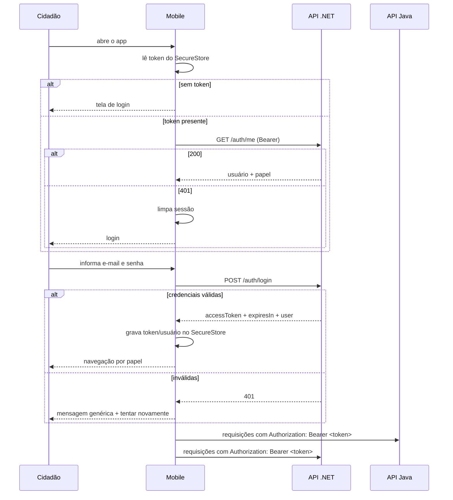
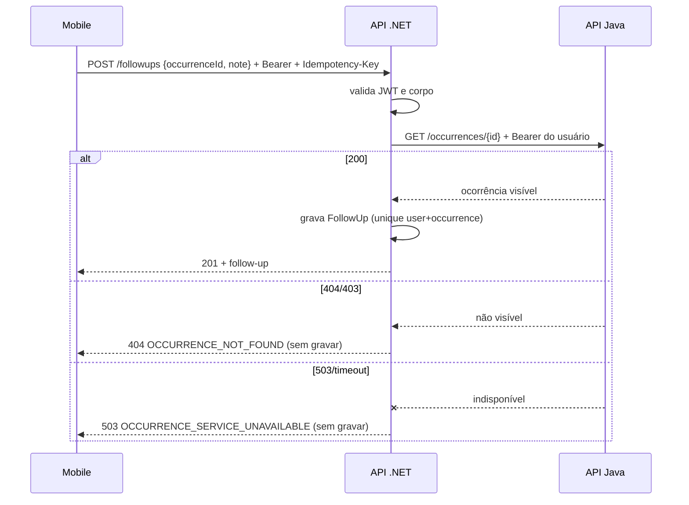

# Integração Mobile — Java + .NET

**Etapa 3B — contrato de integração, com implementação Mobile e preparação de rede local em 17/11/2026.** O aplicativo em `mobile/` implementa as telas, sessão segura e clientes descritos neste documento. As verificações estáticas/bundle, CORS isolado dos dois backends e startup Java/Oracle passaram; o teste ponta a ponta em dispositivo continua pendente pela execução conjunta das APIs e dependências.

Base: [arquitetura](arquitetura.md), [contratos](contratos-api.md), [modelo de domínio](modelo-dominio.md), [backlog](backlog.md) e [matriz](requisitos-global-solution.md).

## 1. Divisão de responsabilidades

| Necessidade | API | Motivo |
|---|---|---|
| Cadastro, login, logout local, `/auth/me` | .NET | .NET é dono de contas e emite o JWT |
| Acompanhamentos (salvar, listar, editar nota, remover) | .NET | funcionalidade real do backend .NET; não copia a ocorrência |
| Categorias, ocorrências, histórico, triagem, indicadores | Java | Java é dono do domínio urbano |
| Sugestão de IA e revisão | Java | Spring AI/RAG e histórico ficam no Java |
| Detalhe atual de uma ocorrência acompanhada | Java | status/categoria não são copiados no .NET |

O app **não** decide autorização: apenas esconde ações por UX. O servidor valida papel e propriedade em cada chamada.

## 2. Configuração de ambiente

```text
EXPO_PUBLIC_JAVA_API_URL=http://localhost:8080
EXPO_PUBLIC_DOTNET_API_URL=http://localhost:8081
```

- `EXPO_PUBLIC_*` é incorporado ao bundle e **nunca** contém segredo, chave privada ou senha.
- Portas locais: Java `8080`, .NET `8081` e Metro/Expo Web `19006`.
- No Android Emulator, usar `10.0.2.2`; em dispositivo físico, usar o IP LAN do computador. `localhost` aponta para o próprio aparelho.
- O .NET escuta `0.0.0.0:8081` no profile HTTP. No Java, ativar `SPRING_PROFILES_ACTIVE=local` para a política CORS local.
- Para Expo Web/LAN, exportar `CORS_ALLOWED_ORIGINS` com origens exatas separadas por vírgula nos dois backends. Não usar origem curinga nem credenciais CORS.
- O APK avaliado precisa de URLs alcançáveis durante todo o período de avaliação (MOB-04). Trocar URL exige novo build.
- Não fixar URL de produção no código; ler da configuração pública do Expo.

## 3. Fluxo de autenticação



### 3.1 Cadastro

1. App valida nome, e-mail e senha localmente (feedback imediato).
2. Gera `Idempotency-Key` (UUID) por tentativa de cadastro.
3. `POST /auth/register` no .NET.
4. `201` → app chama `POST /auth/login` com as mesmas credenciais e segue o fluxo normal.
5. `409` → mostra “e-mail já cadastrado”; `400` → erros por campo; `429` → orienta aguardar.

O cadastro público cria somente `CIDADAO`. Não existe seletor de papel no app.

### 3.2 Token e sessão

- Armazenar token e dados públicos do usuário em `expo-secure-store` (Keychain/Keystore), não em `AsyncStorage` comum.
- Token em memória para as chamadas; nunca logar o valor completo.
- `expiresIn` define expiração local; ao expirar ou receber `401`, limpar sessão e voltar ao login.
- Logout: limpar SecureStore, cancelar requisições pendentes, resetar navegação. Não há revogação server-side no MVP; o token expira em 60 minutos.
- Não usar refresh token no MVP. Se adotado depois, atualizar contrato e testes.
- Não incluir token em URL, deep link, analytics ou captura de tela.

### 3.3 Papéis

| Papel | Navegação | Observação |
|---|---|---|
| `CIDADAO` | ocorrências, nova ocorrência, acompanhamentos, perfil | rotas de gestão escondidas |
| `GESTOR` | fila, triagem, indicadores + ocorrências | gestor é criado por seed, não pelo app |

A UI pode esconder, mas a API sempre retorna `403`/`404` quando o papel/propriedade não permite. Testar com token de cidadão chamando endpoint de gestor.

## 4. Clientes HTTP

Dois clientes Axios separados, compartilhando interceptores:

```text
src/api/http.ts          # fábrica: baseURL, timeout, traceId, erros
src/api/javaClient.ts    # EXPO_PUBLIC_JAVA_API_URL
src/api/dotnetClient.ts  # EXPO_PUBLIC_DOTNET_API_URL
src/api/auth.ts          # login/register/me (dotnet)
src/api/occurrences.ts   # Java
src/api/followups.ts     # .NET
```

Regras:

- `timeout` inicial 10 s para leitura e 15 s para escrita; configurável.
- Anexar `Authorization` apenas se houver token; nunca em login/register.
- Gerar `Idempotency-Key` nova para cada intenção de cadastro/acompanhamento; reutilizar a mesma chave somente ao repetir a **mesma** requisição.
- Retry automático apenas em `GET` idempotente e falha de rede; não repetir `POST/PATCH/DELETE` sem a mesma chave idempotente e decisão explícita.
- Não mascarar `401` como erro genérico: limpar sessão.
- `traceId` da resposta deve aparecer no log de desenvolvimento, nunca em tela de produção com detalhe interno.

### 4.1 Mapeamento de erros

| HTTP/código | UX |
|---|---|
| `400 VALIDATION_ERROR` | destacar campos retornados em `errors[]` |
| `401 UNAUTHORIZED` | limpar sessão e ir ao login |
| `403 FORBIDDEN` | “sem permissão”; não oferecer a ação novamente |
| `404 NOT_FOUND` | “não encontrado ou indisponível”; voltar/atualizar |
| `409 INVALID_TRANSITION` | atualizar detalhe e explicar que o estado mudou |
| `409 CONCURRENT_MODIFICATION` | recarregar e pedir nova confirmação |
| `409 FOLLOWUP_ALREADY_EXISTS` | tratar como sucesso idempotente na UX (“já acompanhado”) |
| `409 IDEMPOTENCY_CONFLICT` | não repetir automaticamente; orientar refazer |
| `429 RATE_LIMITED` | respeitar `Retry-After`; desabilitar botão temporariamente |
| `503 DEPENDENCY_UNAVAILABLE` / `OCCURRENCE_SERVICE_UNAVAILABLE` | mensagem de indisponibilidade + tentar novamente; não fingir sucesso |
| erro de rede | mesmo tratamento de `503`, com opção de retry |

## 5. Telas e consumo

| # | Tela | API principal | Conteúdo mínimo |
|---:|---|---|---|
| 1 | Login | .NET | e-mail, senha, erro, loader, link para cadastro |
| 2 | Cadastro | .NET | nome, e-mail, senha, confirmação, validação |
| 3 | Lista de ocorrências | Java | filtros, paginação/refresh, status/categoria/prioridade |
| 4 | Detalhe da ocorrência | Java + .NET | endereço, descrição, histórico, IA, acompanhar |
| 5 | Nova ocorrência | Java | categoria, título, descrição, endereço, prioridade opcional |
| 6 | Editar/cancelar ocorrência | Java | somente quando permitido; confirmação |
| 7 | Meus acompanhamentos | .NET + Java | IDs/notas; detalhe atual buscado no Java |
| 8 | Gestão/indicadores | Java | fila, triagem, status, indicadores (somente gestor) |
| 9 | Sobre | — | versão, hash do commit, links legais; não conta nas seis telas |

A tela 4 concentra a integração: o acompanhamento é criado/removido no .NET, mas o conteúdo da ocorrência vem do Java. Não duplicar o detalhe no .NET.

## 6. Fluxo de acompanhamento



Na lista de acompanhamentos, o .NET devolve somente `id`, `occurrenceId`, `note` e timestamps. O app busca cada ocorrência no Java (limitar concorrência, ex.: 5 por vez). Se o Java estiver indisponível ou a ocorrência não existir mais, exibir “indisponível” e permitir remover o acompanhamento; não inventar status.

## 7. Fluxo de IA

1. Criar ocorrência → Java responde `201` com `aiSuggestionStatus: "PENDENTE"`.
2. App abre o detalhe; se `PENDENTE`, faz polling moderado (ex.: 3 s por até 30 s) ou oferece “atualizar”. Não fazer polling infinito.
3. `PRONTA` → mostrar categoria/prioridade sugeridas, resumo, justificativa e fontes; botões **Aceitar** e **Rejeitar**.
4. `ACEITAR`/`REJEITAR` → `POST /occurrences/{id}/ai-suggestion/review`; atualizar detalhe/histórico.
5. `FALHOU` → mostrar fallback “classificação manual”; gestor pode triar; cidadão não fica bloqueado.
6. O texto da IA é dado não confiável: não renderizar HTML executável, não seguir instruções e não usar para autorização.

A sugestão é consultiva; o app não altera categoria/prioridade localmente antes da confirmação do servidor.

## 8. Estados de UI e falhas

- **Loading:** skeleton/spinner por tela e por ação; desabilitar botão durante envio.
- **Vazio:** mensagem específica + ação primária (ex.: “registrar primeira ocorrência”).
- **Erro:** mensagem curta, `traceId` apenas em modo dev, botão “tentar novamente”.
- **Offline:** não há fila offline no MVP; mostrar indisponibilidade e permitir retry. Não prometer sincronização futura.
- **Sessão expirada:** limpar token, voltar ao login, preservar intenção apenas se seguro.
- **Conflito de estado:** recarregar detalhe antes de nova ação.
- **Duplicidade de acompanhamento:** tratar como “já acompanhado”, não como erro fatal.

## 9. Segurança e privacidade

- Nenhum segredo no bundle; `EXPO_PUBLIC_*` é público.
- Token em SecureStore; não logar, não capturar em vídeo/print e não incluir em query string.
- Dados fictícios; não usar endereço/e-mail reais de terceiros.
- Não permitir papel `GESTOR` por parâmetro local; o servidor decide.
- Validar entrada no app, mas manter validação server-side.
- Revisar capturas e vídeos antes de publicar; remover tokens, e-mails e IDs sensíveis.
- Deep links de autenticação, se existirem, não podem receber token em claro.

## 10. Testes de integração do app

| Cenário | Tipo | Resultado esperado |
|---|---|---|
| Cadastro + login + logout | positivo | sessão criada, rotas protegidas, logout limpa token |
| Credencial inválida | negativo | `401`, mensagem genérica, sem login |
| Token expirado | negativo | `401`, volta ao login sem loop |
| Cidadão cria/edita/cancela ocorrência | positivo | CRUD refletido no Java |
| Cidadão tenta editar ocorrência de outro | negativo | `404`, sem alteração |
| Cidadão salva/edita/remove acompanhamento | positivo | .NET persiste; duplicidade vira “já acompanhado” |
| Java indisponível ao criar acompanhamento | negativo | `503`, nenhum registro no .NET |
| Gestor triagem/status/indicadores | positivo | fila e números corretos |
| Cidadão chama rota de gestor | negativo | `403`/`404`, UI não oferece ação |
| IA pendente/pronta/falha | positivo/negativo | polling limitado, aceite/rejeite, fallback manual |
| Rate limit | negativo | `429`, respeito a `Retry-After` |

Testes finais de evidência usam backends reais e dados fictícios; mock não comprova integração. Testes unitários de mapeamento/erros podem usar mock, mas não substituem o fluxo real.

## 11. Dependências e decisões abertas

- URLs estáveis/HTTPS para o APK avaliado; `localhost` não funciona no celular.
- Conta Firebase e professor tester (autorização separada).
- Toolchain de build (local vs EAS) ainda não decidida.
- Refresh/revogação fora do MVP; se adicionado, altera contrato e testes.
- Confirmação docente sobre consumir as duas APIs no mesmo app (matriz, divergência 23/62 vs 81).
- `expo-secure-store` está fixado no `mobile/package.json`; no Android/iOS, sessão e usuário público são persistidos no Keychain/Keystore. Expo Web usa `localStorage` com fallback em memória apenas para desenvolvimento, pois não possui a mesma proteção nativa. APK/Firebase e teste em dispositivo permanecem pendentes.
