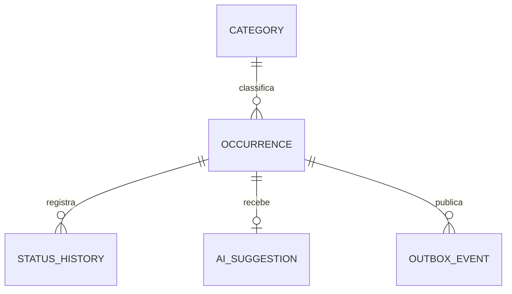
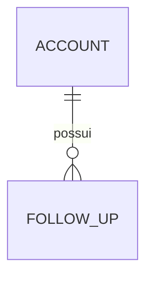
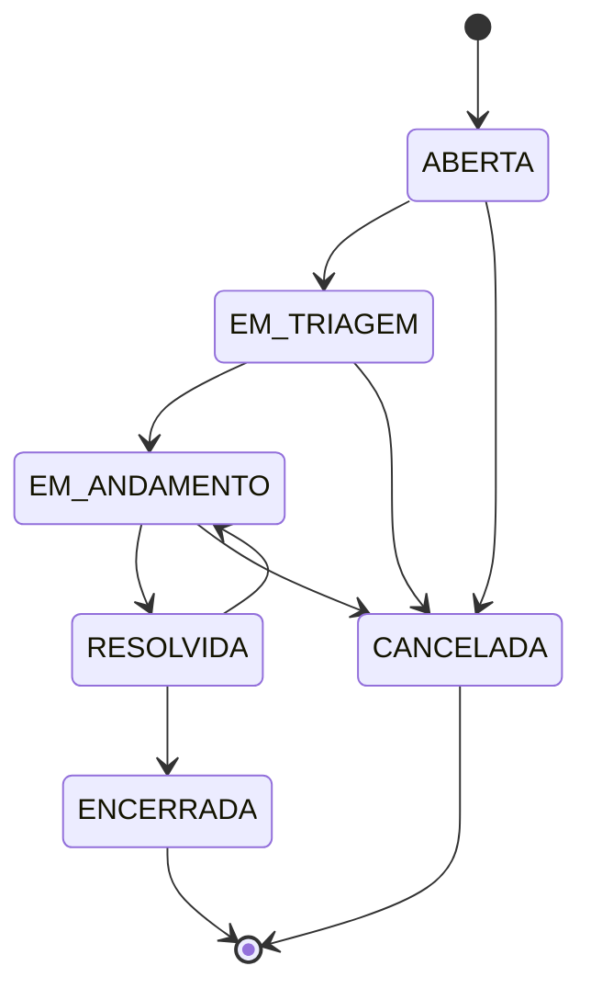

# Modelo de domínio conceitual — CityTech

**Etapa 3B — proposta de modelagem, 17/11/2026, atualizada após a persistência real.** Este documento define vocabulário, entidades, relacionamentos e regras; as seções 8.1 e 8.2 registram os schemas Oracle e SQL Server efetivamente validados.

> **Atualização da Etapa 4A (17/11/2026):** o modelo **.NET** da seção 4 foi implementado com EF Core e migration aplicada ao SQL Server; a seção 8.2 registra o schema real conferido. As seções Java/Oracle e MongoDB continuam **conceituais**, sem DDL executado. O texto original da 3B é preservado como registro histórico; onde a implementação divergiu da proposta, a diferença está explicitada.

> **Atualização Java/Oracle (17/11/2026):** as entidades JPA foram exercitadas com H2 e o DDL físico foi executado em Oracle XE 21. O backend iniciou com o driver Oracle e `ddl-auto: validate`; scripts e evidências estão em `database/oracle/`. A repetição no ambiente institucional depende das credenciais da FIAP.

> **Atualização MongoDB (17/11/2026):** o snapshot documental foi implementado e exercitado em MongoDB 8.0.38. Três collections, validators, índices, 30 documentos e 25 assertions estão em `database/mongodb/`; os três relatórios comparáveis coincidem com a amostra Oracle.

Fontes: [arquitetura](arquitetura.md), [backlog](backlog.md), [contratos](contratos-api.md) e [matriz](requisitos-global-solution.md). Onde há escolha de produto, o texto diz “decisão do projeto”; onde há obrigação acadêmica, referencia o ID da matriz.

## 1. Princípios

1. **Um dono por dado:** .NET é dono de contas, credenciais e acompanhamentos; Java é dono de categorias, ocorrências, histórico e sugestões de IA.
2. **Sem FK entre bancos:** referências entre Oracle e SQL Server usam UUIDs opacos. Não há transação distribuída nem escrita dupla.
3. **Histórico append-only:** a trilha de uma ocorrência não é editada nem apagada por endpoint. Exclusão de ocorrência é cancelamento lógico.
4. **Autorização no servidor:** papel e propriedade são verificados em cada backend, mesmo que o Mobile esconda a ação.
5. **Datas UTC em ISO-8601**, IDs UUID, dinheiro não se aplica e coordenadas ficam fora do MVP.
6. **Concorrência otimista:** operações de alteração usam `version`; conflito retorna `409`.
7. **Dados fictícios:** nenhum dado pessoal real, endereço real de terceiro ou integração oficial com prefeitura.

## 2. Contextos e propriedade

| Contexto | Dono | Entidades | Persistência | Consumidores |
|---|---|---|---|---|
| Identidade | .NET | `Account`, `IdempotencyRecord` | SQL Server local / Azure SQL futuro | Mobile, Java (validação de JWT) |
| Acompanhamento | .NET | `FollowUp` | SQL Server local / Azure SQL futuro | Mobile |
| Ocorrências | Java | `Category`, `Occurrence`, `StatusHistory`, `AiSuggestion`, `OutboxEvent` | Oracle | Mobile, .NET (validação de referência) |
| Operação/IA | Java | sugestão, histórico, indicadores | Oracle + RabbitMQ + corpus | Mobile, gestores |
| Relatório documental | Scripts | `ocorrencias`, `categorias` | MongoDB | Demonstração acadêmica |

O Java **não** guarda senha, e-mail ou perfil completo. O `citizen_id`/`actor_id` é o `sub` do JWT, um UUID opaco. O .NET **não** guarda cópia editável da ocorrência nem o status atual; guarda apenas `occurrenceId` no acompanhamento.

## 3. Modelo Java (Oracle)

### 3.1 `Category`

| Campo | Tipo conceitual | Regra |
|---|---|---|
| `id` | UUID | PK gerada pelo Java |
| `code` | string(40) | único, maiúsculo, estável (`VIAS`, `ILUMINACAO`, `ACESSIBILIDADE`, `DESCARTE`, `AGUA`, `OUTROS`) |
| `name` | string(80) | rótulo exibido |
| `description` | string(255) | opcional |
| `active` | boolean | categorias inativas não aceitam novas ocorrências |
| `created_at` / `updated_at` | timestamp UTC | auditoria básica |

### 3.2 `Occurrence`

| Campo | Tipo conceitual | Regra |
|---|---|---|
| `id` | UUID | PK |
| `citizen_id` | UUID | `sub` do JWT; sem FK para SQL Server |
| `category_id` | UUID | FK interna para `Category` |
| `title` | string(120) | 5–120 caracteres |
| `description` | string(2000) | 20–2000 caracteres |
| `priority` | enum | `BAIXA`, `MEDIA`, `ALTA`, `CRITICA`; padrão `MEDIA` |
| `status` | enum | ver seção 5 |
| `address_street` | string(160) | obrigatório |
| `address_number` | string(20) | obrigatório; aceita `S/N` |
| `address_complement` | string(80) | opcional |
| `address_district` | string(100) | obrigatório |
| `address_city` | string(100) | obrigatório |
| `address_state` | char(2) | UF |
| `address_postal_code` | string(9) | opcional; formato `00000-000` quando informado |
| `version` | bigint | concorrência otimista |
| `created_at` / `updated_at` | timestamp UTC | ordenação e auditoria |
| `cancelled_at` | timestamp UTC | preenchido no cancelamento |
| `cancellation_reason` | string(255) | obrigatório no cancelamento |

Fotos não fazem parte da tabela mínima. Se forem implementadas, usar entidade separada `OccurrencePhoto` com `storage_key`, `content_type`, tamanho e checksum; upload e armazenamento ficam em P2 e não bloqueiam o CRUD.

### 3.3 `StatusHistory`

| Campo | Tipo conceitual | Regra |
|---|---|---|
| `id` | UUID | PK |
| `occurrence_id` | UUID | FK interna; `ON DELETE` não remove histórico |
| `action` | enum | `CRIACAO`, `EDICAO`, `TRIAGEM`, `TRANSICAO`, `CANCELAMENTO`, `REVISAO_IA` |
| `from_status` | enum/null | nulo na criação |
| `to_status` | enum/null | nulo em edição que não muda status |
| `actor_id` | UUID | `sub` do JWT |
| `actor_role` | enum | `CIDADAO` ou `GESTOR` |
| `note` | string(500) | opcional; obrigatório em cancelamento/transição relevante |
| `created_at` | timestamp UTC | imutável |

Não existe endpoint para atualizar ou apagar histórico. A correção de um erro de operação, se necessária, gera novo registro, não reescreve o anterior.

### 3.4 `AiSuggestion`

| Campo | Tipo conceitual | Regra |
|---|---|---|
| `id` | UUID | PK |
| `occurrence_id` | UUID | FK única (uma sugestão corrente por ocorrência no MVP) |
| `status` | enum | `PENDENTE`, `PRONTA`, `ACEITA`, `REJEITADA`, `FALHOU` |
| `suggested_category_id` | UUID/null | categoria sugerida; validada contra o catálogo |
| `suggested_priority` | enum/null | prioridade sugerida |
| `summary` | string(500) | resumo sugerido |
| `justification` | string(2000) | justificativa curta, tratada como dado não confiável |
| `sources_json` | CLOB/JSON | IDs/trechos do corpus usados na recuperação |
| `model` | string(100) | modelo/provedor usado |
| `prompt_version` | string(40) | versão do prompt/taxonomia |
| `error_code` | string(60) | preenchido em falha |
| `created_at` | timestamp UTC | geração |
| `reviewed_at` / `reviewed_by` | timestamp/UUID | decisão humana |
| `decision` | enum/null | `ACEITAR` ou `REJEITAR` |
| `review_note` | string(500) | opcional |

A sugestão **não altera** categoria/prioridade até a revisão humana. O texto gerado é exibido como conteúdo não confiável, sem executar instruções nele contidas.

### 3.5 `OutboxEvent` (técnica)

| Campo | Tipo conceitual | Regra |
|---|---|---|
| `id` | UUID | também `eventId` |
| `aggregate_id` | UUID | ocorrência |
| `event_type` | string(80) | `OccurrenceCreated` |
| `schema_version` | int | `1` |
| `payload` | CLOB/JSON | evento serializado |
| `occurred_at` | timestamp UTC | momento do fato |
| `published_at` | timestamp/null | confirmação de envio |
| `attempts` | int | tentativas de publicação |

A gravação da ocorrência e do evento ocorre na mesma transação. O publicador pode repetir o envio; o consumidor deduplica por `eventId`.

### 3.6 Relacionamentos Java

- `Category` 1:N `Occurrence`.
- `Occurrence` 1:N `StatusHistory`.
- `Occurrence` 1:0..1 `AiSuggestion` no MVP.
- `Occurrence` 1:N `OutboxEvent` (técnica, não exposta ao Mobile).

## 4. Modelo .NET (SQL Server / Azure SQL)

### 4.1 `Account`

| Campo | Tipo conceitual | Regra |
|---|---|---|
| `id` | UUID | PK; vira `sub` do JWT |
| `name` | string(120) | 2–120 caracteres |
| `email` | string(254) | exibição |
| `email_normalized` | string(254) | único, minúsculo, usado no login |
| `password_hash` | string | hash do ASP.NET Core Identity; nunca retornado |
| `role` | enum | `CIDADAO` ou `GESTOR`; cadastro público só `CIDADAO` |
| `active` | boolean | contas inativas não autenticam |
| `created_at` / `updated_at` | timestamp UTC | auditoria |
| `version` | bigint | concorrência otimista |

### 4.2 `FollowUp`

| Campo | Tipo conceitual | Regra |
|---|---|---|
| `id` | UUID | PK |
| `user_id` | UUID | FK interna para `Account` |
| `occurrence_id` | UUID | ID opaco do Java; sem FK cruzada |
| `note` | string(500) | opcional; preferência local |
| `created_at` / `updated_at` | timestamp UTC | auditoria |
| `version` | bigint | concorrência otimista |

Restrição única (`user_id`, `occurrence_id`). Não há coluna de status, categoria, prioridade ou descrição da ocorrência. O detalhe atual é obtido no Java pelo Mobile.

### 4.3 `IdempotencyRecord` (técnica)

| Campo | Tipo conceitual | Regra |
|---|---|---|
| `id` | UUID | PK |
| `scope` | string(120) | rota + usuário (ou `register` + IP, quando aplicável) |
| `key` | string(128) | `Idempotency-Key` |
| `request_hash` | string(64) | SHA-256 do corpo canônico |
| `status_code` | int | resposta original |
| `response_body` | text | resposta original, sem segredo |
| `created_at` / `expires_at` | timestamp UTC | retenção mínima de 24 h |

Restrição única (`scope`, `key`). A tabela é técnica; não entra na contagem das duas tabelas de negócio exigidas em DevOps.

### 4.4 Relacionamentos .NET

`Account` 1:N `FollowUp`. `IdempotencyRecord` é técnica e não se relaciona por FK de negócio.

## 5. Estados e transições

### 5.1 Enum `OccurrenceStatus`

| Valor | Significado | Terminal? |
|---|---|---|
| `ABERTA` | criada, aguardando triagem | não |
| `EM_TRIAGEM` | gestor iniciou a análise | não |
| `EM_ANDAMENTO` | atendimento em execução | não |
| `RESOLVIDA` | gestor marcou como resolvida, aguardando confirmação | não |
| `ENCERRADA` | confirmada e encerrada | sim |
| `CANCELADA` | cancelada por cidadão ou gestor | sim |

### 5.2 Transições permitidas

| De | Para | Quem pode | Condição/registro |
|---|---|---|---|
| `ABERTA` | `EM_TRIAGEM` | `GESTOR` | início da triagem; histórico |
| `ABERTA` | `CANCELADA` | proprietário `CIDADAO` ou `GESTOR` | motivo obrigatório |
| `EM_TRIAGEM` | `EM_ANDAMENTO` | `GESTOR` | histórico |
| `EM_TRIAGEM` | `CANCELADA` | `GESTOR` | motivo obrigatório |
| `EM_ANDAMENTO` | `RESOLVIDA` | `GESTOR` | nota de resolução recomendada |
| `EM_ANDAMENTO` | `CANCELADA` | `GESTOR` | motivo obrigatório; exceção operacional |
| `RESOLVIDA` | `ENCERRADA` | proprietário `CIDADAO` ou `GESTOR` | confirmação |
| `RESOLVIDA` | `EM_ANDAMENTO` | proprietário `CIDADAO` ou `GESTOR` | reabertura com justificativa |
| `ENCERRADA` | — | — | estado terminal |
| `CANCELADA` | — | — | estado terminal |

Transição não listada retorna `409 INVALID_TRANSITION`. Atores sem papel/propriedade recebem `403`/`404` conforme o contrato. O endpoint `DELETE /occurrences/{id}` é um atalho para cancelamento: aplica a mesma regra e retorna `409` quando o estado não permite.

### 5.3 Regras de edição

- O proprietário pode editar título, descrição, categoria, prioridade e endereço somente em `ABERTA`.
- Após `EM_TRIAGEM`, a descrição e o endereço são imutáveis para preservar a evidência; o gestor ajusta categoria/prioridade pela triagem.
- O gestor pode registrar nota e mudar categoria/prioridade em estados não terminais, com histórico.
- O cancelamento é lógico: `status=CANCELADA`, `cancelled_at`, motivo e histórico; a linha permanece para auditoria.
- Reabertura (`RESOLVIDA → EM_ANDAMENTO`) exige justificativa e não apaga a resolução anterior; o histórico mostra ambas.

## 6. Regras e invariantes

| ID | Regra |
|---|---|
| R1 | Criar ocorrência exige papel `CIDADAO`, categoria ativa; `priority` omitida vira `MEDIA`; `status` inicial é `ABERTA`; `citizen_id` é o `sub` do JWT. |
| R2 | Cidadão só lê/edita ocorrências com `citizen_id` igual ao `sub`; gestor lê todas. |
| R3 | Ocultar existência: acesso de outro cidadão retorna `404`, não `403`, para não vazar IDs. |
| R4 | Edição de conteúdo do cidadão só em `ABERTA`; depois, `409`. |
| R5 | Toda mudança relevante grava `StatusHistory` na mesma transação. |
| R6 | Histórico é imutável e não possui endpoint de exclusão. |
| R7 | `version` é incrementada a cada alteração; conflito retorna `409 CONCURRENT_MODIFICATION`. |
| R8 | Acompanhamento é único por (`user_id`, `occurrence_id`); não copia status. |
| R9 | Criar acompanhamento exige ocorrência visível no Java; falha do Java não grava. |
| R10 | Categoria em uso é desativada, nunca apagada fisicamente. |
| R11 | Gestor é criado por seed/configuração controlada; cadastro público não aceita `role` diferente de `CIDADAO`. |
| R12 | Sugestão de IA é consultiva; só a revisão humana altera a ocorrência. |
| R13 | Evento de ocorrência é publicado via outbox; consumo é idempotente por `eventId`. |
| R14 | Nenhuma operação grava simultaneamente em Oracle, SQL Server e MongoDB. |
| R15 | Datas são UTC; a API não aceita timezone implícito do cliente. |

## 7. Enums e vocabulário

| Enum | Valores | Observação |
|---|---|---|
| `Role` | `CIDADAO`, `GESTOR` | claim `roles`; UI não concede papel |
| `OccurrenceStatus` | `ABERTA`, `EM_TRIAGEM`, `EM_ANDAMENTO`, `RESOLVIDA`, `ENCERRADA`, `CANCELADA` | ver seção 5 |
| `Priority` | `BAIXA`, `MEDIA`, `ALTA`, `CRITICA` | ordenação e indicadores |
| `HistoryAction` | `CRIACAO`, `EDICAO`, `TRIAGEM`, `TRANSICAO`, `CANCELAMENTO`, `REVISAO_IA` | append-only |
| `AiSuggestionStatus` | `PENDENTE`, `PRONTA`, `ACEITA`, `REJEITADA`, `FALHOU` | uma sugestão corrente no MVP |
| `AiDecision` | `ACEITAR`, `REJEITAR` | revisão humana |

Códigos de categoria e valores de enum são ASCII, sem acentos, para evitar ambiguidade em JSON, banco e URLs.

## 8. Mapeamento físico proposto

### 8.1 Oracle — implementado e validado localmente

| Tabela | PK | FKs/índices principais |
|---|---|---|
| `categories` | `id` | unique `code`; check `active` |
| `occurrences` | `id` | FK `category_id`; índices `citizen_id`, `status`, `priority`, `created_at`, (`status`,`category_id`) |
| `status_history` | `id` | FK `occurrence_id`; índice (`occurrence_id`,`created_at`) |
| `ai_suggestions` | `id` | unique `occurrence_id`; FKs de ocorrência/categoria |
| `processed_events` | `id` | deduplicação do consumidor |
| `outbox_events` | `id` | índice (`published_at`,`occurred_at`) |
| `occurrence_audit` | `id` numérico | tabela acadêmica alimentada por trigger; não é entidade JPA |

O schema usa `RAW(16)` para UUID, `TIMESTAMP(6) WITH TIME ZONE` para `Instant`, `CLOB` para os dois `@Lob`, `NUMBER(1,0)` para boolean e `NUMBER(10/19,0)` para inteiros. IDs JPA são atribuídos pela aplicação e não usam sequence; apenas a auditoria usa `seq_occurrence_audit`. DDL, seed, packages, triggers, testes e relatórios foram aprovados em Oracle XE 21, compatível com a sintaxe baseline 19c.

### 8.2 SQL Server — implementado na 4A

Schema real aplicado pela migration `20261117072823_InitialCreate` e conferido por consulta ao SQL Server:

| Tabela | PK | Restrições/índices verificados |
|---|---|---|
| `accounts` | `id` | unique `email_normalized`; checks de comprimento do nome, papel, versão e e-mail normalizado minúsculo |
| `follow_ups` | `id` | FK `user_id` → `accounts` com cascade; unique (`user_id`,`occurrence_id`); check de versão e de nota não vazia; **sem FK** para `occurrence_id` |
| `idempotency_records` | `id` | unique (`scope`,`idempotency_key`); índice `expires_at`; checks de tamanho, hash SHA-256, status HTTP e expiração |

Nomes físicos em `snake_case`, PKs UUID e timestamps `datetime2(7)` UTC. O token `version` é de concorrência otimista e é incrementado no `SaveChanges`.

Duas propostas da 3B **não** foram criadas na 4A: índice isolado em `accounts.role` e índice isolado em `follow_ups.occurrence_id`. Ainda não há consulta/endpoint que os justifique; reavaliar quando o CRUD e a consulta por ocorrência forem implementados, antes de considerar o schema definitivo. EF Core é dono das migrações. O DDL da entrega DevOps será exportado/revisado para `/scripts/script-bd.sql` na etapa correspondente, sem duas fontes divergentes.

### 8.3 MongoDB — implementado e validado localmente

1. `categorias`: 6 documentos com `_id`/`oracleId` iguais ao UUID Oracle, código único, metadados e versão do snapshot.
2. `ocorrencias`: 12 documentos autocontidos com categoria, endereço, histórico e sugestão IA incorporados; índices atendem categoria/status, fila, bairro, data e estado da IA.
3. `eventos_triagem`: 12 documentos append-only equivalentes a `status_history`, desnormalizados com categoria e bairro para análise operacional.

As três collections usam `$jsonSchema` estrito e índices únicos de rastreabilidade. Datas são BSON Date; enums e UUIDs seguem o contrato Java/Oracle. A amostra total possui 30 documentos e os relatórios por categoria, fila não terminal e categoria/status coincidem com `database/oracle/07-reports.sql`. Integração automática Oracle→Mongo **não** é exigida; Oracle permanece fonte transacional e os scripts produzem o snapshot acadêmico.

## 9. Dados fictícios e seeds

- Categorias iniciais: vias/buracos, iluminação, acessibilidade, descarte irregular, água/vazamentos e outros.
- Pelo menos 12 ocorrências cobrindo todos os status, prioridades e categorias, com endereços fictícios.
- Um gestor de demonstração criado por seed controlado; credenciais vêm de configuração local, nunca do repositório.
- Datas e IDs podem ser determinísticos no seed para permitir comparação Oracle/Mongo e testes repetíveis.

## 10. Decisões em aberto

1. Versão e acesso ao Oracle institucional; até confirmar, o DDL é conceitual.
2. Confirmar com o professor se o CRUD de histórico pode ser demonstrado apenas por criação/consulta imutável, sem update/delete.
3. Definir se o cancelamento lógico atende à rubrica de “excluir” do Mobile ou se é necessário outro fluxo demonstrativo.
4. Definir armazenamento de fotos somente se o tempo permitir (P2).
5. Confirmar a política de retenção e o tratamento de conta inativa.
6. Confirmar se o gestor de seed será criado por migration, comando CLI ou script de ambiente.

Essas decisões não bloqueiam o backlog P0; devem ser resolvidas antes da etapa de persistência.
