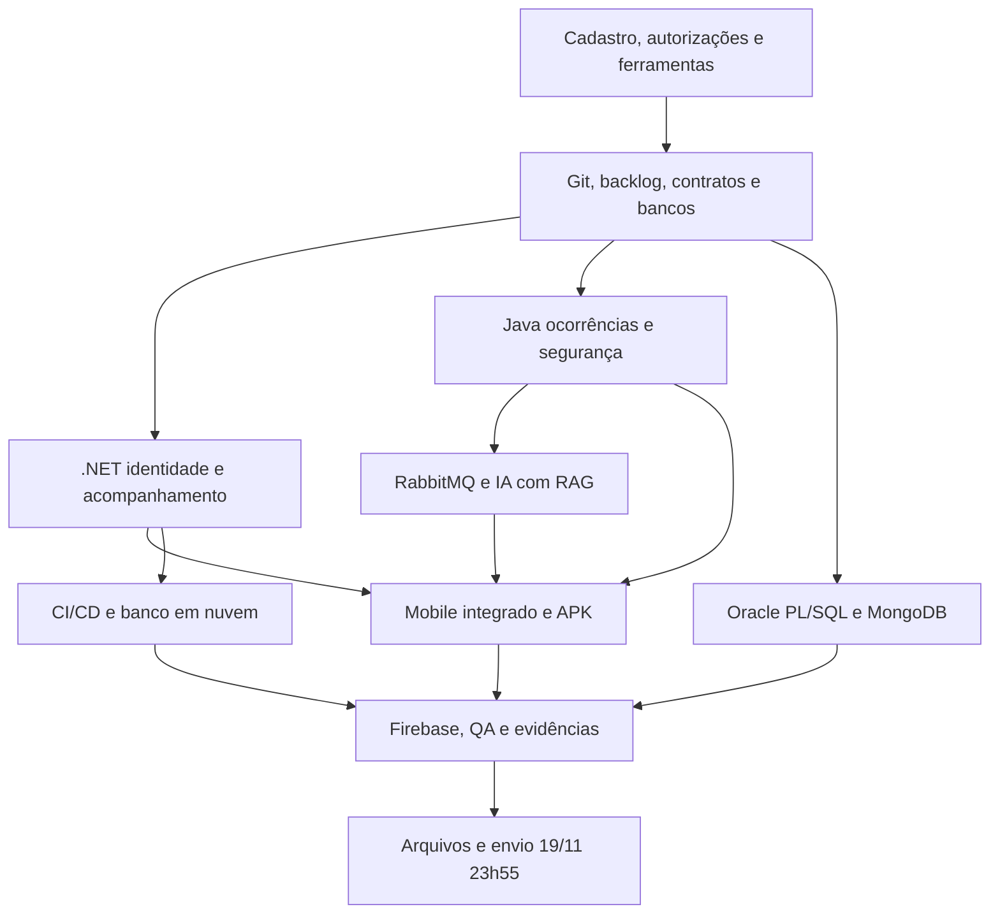

# Plano de desenvolvimento — sete disciplinas

Base: [matriz oficial](requisitos-global-solution.md). Referência temporal: **17/11/2026**. Prazo rígido: **19/11/2026, 23h55**; apresentações 23–27/11; correção até 30/11.

## 1. Situação e prioridade imediata

Ferramentas instaladas/testadas; Git e infraestrutura local preparados na Etapa 3A. Backlog/contratos definidos. As Etapas 4A/5A concluíram .NET com 77 testes; Java/RabbitMQ possuem 41 testes padrão e prova AMQP real; Oracle e snapshot MongoDB locais foram validados. Binding/CORS locais estão implementados e testados, mas o E2E Mobile permanece pendente. Oracle institucional e LLM externo continuam pendentes. **Cumprir integralmente sete disciplinas no prazo tem risco alto**; este plano organiza prioridades e dependências, não promete execução viável por uma pessoa em tempo fixo.

Principais referências da 3B: [backlog](backlog.md), [modelo de domínio](modelo-dominio.md), [contratos](contratos-api.md), [integração Mobile](integracao-mobile.md) e [decisões/riscos](decisoes-e-riscos.md).

Primeiras decisões do aluno/equipe:

1. Confirmar cadastro do grupo (prazo 13/11 já passou) e presença das sete entregas no Portal.
2. Informar integrantes/RMs/turmas/representante e contatos dos professores.
3. Resolver divergências de integração dupla, formato Banco, apresentação .NET, padrões QA e acesso Test Plans.
4. Etapa 2 autorizada para diagnóstico e planejamento em 17/11/2026; aprovar instalações selecionadas e confirmar contas/créditos/ambiente Oracle separadamente.

Etapa 2 aceita como concluída pelo usuário no escopo das ferramentas. A **Etapa 3B** executou backlog/contratos; a **4A** implementou a fundação/persistência .NET; a **5A** implementou e verificou autenticação/JWT/acompanhamentos e requisitos transversais. Oracle XE local está validado; Oracle institucional, Android e acessos externos continuam pendentes.

## 2. Classificação de prioridades

- **P0 — bloqueadores de entrega/zero:** cadastro/Portal/prazo, tema, acesso dos avaliadores, integridade dos artefatos, GitHub público Java autorizado, recursos cloud DevOps, reprodução.
- **P1 — obrigatório e pontuado:** CRUDs, JWT, duas APIs no app, Spring AI + aprofundamento, RabbitMQ, PL/SQL/Mongo, backlog/testes, CI/CD, publicação Firebase.
- **P2 — melhoria/opcional:** fotos completas, mapas/GPS, push, painel web separado, observabilidade avançada, treinamento próprio, IoT físico. Não sacrificar P0/P1 por esses itens.

## 3. Sequência e critérios de saída

| Fase | Trabalho futuro | Dependências | Critério de saída / requisitos | Prioridade |
|---|---|---|---|---|
| 1 — base | Leitura PDF, matriz, diagnóstico, arquitetura, estrutura e configurações | Arquivo oficial | Documentação e verificação; **concluída** | P0 |
| 2 — ambiente e acessos | Git/JDK/.NET/Node, Wrapper, Docker/WSL se escolhido, Oracle; Git local; preparar contas com autorização | Aprovação e acesso ao PC | Versões/hello builds/Compose/SQL verificados; histórico começa antes do código | P0 |
| 3 — backlog e contratos | Epics→Features→PBIs, aceite, Test Cases iniciais, contratos HTTP/JWT, dados e IDs | Padrões de aula e arquitetura | QA-01/02; **3B concluída em documentação**; falta importar ao Boards/professor | P1, antes de programar |
| 4 — modelagem e persistência | Oracle ≥3 entidades Java, .NET contas/acompanhamentos, políticas CRUD/auditoria, dados fictícios | Contratos, bancos acessíveis | JAV-02, DB-01; .NET e Oracle XE local concluídos/validados; FIAP pendente | P1 |
| 5A — .NET vertical | Cadastro/login/JWT, acompanhamentos, Swagger, idempotência, 429, health, xUnit | Banco .NET e contrato; Java para referência integrada | **Concluída localmente**; integração positiva com Java/Mobile pendente | P1 |
| 5B — Java vertical | JPA/CRUD/paginação, DTO/erros, JWT/papéis, endpoints gestão/indicadores, Swagger | Oracle, contrato JWT/chave pública | **Implementada/testada com H2 e Oracle XE 21**; integração Mobile pendente | P1 |
| 6 — assíncrono + IA | RabbitMQ produtor/consumidor, corpus, recuperação RAG, LLM, revisão humana, falhas e avaliação | Fluxo de ocorrência + modelo autorizado | RabbitMQ e pipeline/revisão implementados; **LLM/embeddings reais e avaliação pendentes** | P1 |
| 7 — Mobile | Telas, duas APIs, login/logout/rotas, CRUD, feedback, estilos, hash Sobre; APK | Contratos; integração real depende de 5A/5B/6 | MOB-01 a MOB-12; ≥6 telas sem contar Sobre; Firebase | P1 |
| 8 — PL/SQL/Mongo | Completar blocos, 2 funções/2 procedimentos, triggers/pacotes/testes; 2 collections/10 docs/3 consultas | Modelo definido, amostra comum | **Oracle/PLSQL e MongoDB comparável validados localmente**; Oracle institucional pendente | P1 |
| 9 — CI/CD e cloud | Boards/Repos/políticas, CLI/DDL, build/test/artefatos, CD automático, comprovação SQL | Git e esqueleto buildável desde 5; conta/custos autorizados | DEV-01 a DEV-20 e vídeo com fluxo real | P0/P1 |
| 10 — integração/QA | Rodar casos positivos/negativos por Feature no Test Plans, relatórios e regressão | Incrementos funcionais | QA-03 a QA-10; evidências completas, falhas registradas | P1 contínuo |
| 11 — entrega e defesa | Revisar README, links/acessos, vídeos, PDF QA/DevOps, TXT/ZIP por disciplina; ensaio | Evidências e release | Sete entregas conferidas no Portal e roteiros de defesa | P0 |

A numeração é lógica, **não exige esperar todas as fases anteriores terminarem**. QA começa na fase 3 e acompanha cada incremento. Pipeline começa quando existir primeiro build real, antes de toda a aplicação ficar pronta. Evidências são capturadas ao longo do trabalho.

## 4. Trabalho que pode ocorrer em paralelo

Distribuição sugerida para integrantes humanos, sem presumir tamanho da equipe:

- Após contratos: backend Java e .NET em paralelo, com `sub`/roles/erros definidos.
- Modelagem Oracle/PLSQL e corpus RAG podem avançar enquanto o app implementa navegação e clientes tipados.
- QA prepara casos por Feature enquanto os desenvolvedores implementam; execução só conta quando real.
- DevOps prepara scripts/pipelines a partir do primeiro serviço compilável; publicação depende de autorização/conta.
- Mongo depende da amostra e modelo Oracle estáveis, mas não de todas as telas Mobile.
- Roteiros de pitch/apresentação podem ser redigidos cedo; gravação deve mostrar produto funcionando.

Usar branch por tarefa, PR e Work Item; evitar edição concorrente de contratos/modelos sem acordo. Não foram iniciados agentes paralelos nesta etapa.

## 5. Caminho crítico

O acesso Oracle, serviço de IA, Test Plans, build APK e aprovação/acesso cloud podem bloquear o caminho sem depender de código. Resolver cedo.

## 6. Janela real até a entrega

| Data | Meta de planejamento, condicionada à autorização/equipe | Alerta |
|---|---|---|
| 17/11 | Concluir Etapa 1, validar cadastro/acessos, decidir stack e autorizar ferramentas | Não supor cadastro regularizado |
| 18/11 | Incrementos verticais, CI cedo, testes/capturas contínuos, integração e primeiro APK | Escopo amplo para um dia; reavaliar capacidade a cada marco |
| 19/11 | Priorizar correções bloqueadoras, versões finais, vídeos/PDFs/arquivos; meta interna de upload até 21h55 | 21h55 é margem proposta, **não prazo oficial** |
| 23–27/11 | Defesa de cada disciplina, app/backends disponíveis, todos compreendendo decisões | Não usar essa janela para presumir alteração da entrega de 19/11 |
| Até 30/11 | Acompanhar correção e manter acesso até confirmação de término da avaliação | Não desligar recursos sem confirmar avaliação/custos com usuário |

Se não houver capacidade para tudo, comunicar objetivamente quais requisitos estão pendentes e quais pontos ficam em risco. Não simular resultados, histórico, capturas ou links.

## 7. O que vale pontos

| Disciplina | Rubrica de entrega | Defesa |
|---|---|---|
| .NET | API/Swagger 20; JWT 20; idempotência 15; rate limit 15; testes 20; health 10 | 30% |
| QA | Hierarquia 20; Feature/aceite 20; testes ±20; sumários 20; passos 20 (rubrica com peso 70%) | 30% |
| DevOps | Arquitetura 10; Boards/Repos 10; CI 25; CD 25 | 30 pontos |
| IA | Problema 10; integração generativa 25; aprofundamento 25; dados/arquitetura 15; avaliação 15; organização 10 | 30% |
| Java | CRUD 20; validação 10; JWT 20; Spring AI 20; distribuído 20; docs/Mobile 10 | 30% |
| Banco | Oracle/blocos 10; funções/procedimentos 15; triggers 10; pacotes 10; Mongo 10; mapa/relatórios 15 | 30 pontos |
| Mobile | Telas 10; CRUD 30; auth 20; estilo 5; arquitetura 20; vídeo 10; publicação 5 | 30% |

Ver detalhes e páginas na matriz. Requisitos de entrega sem linha própria de pontos podem causar descontos graves. Cumprir um item de 5 pontos não elimina uma penalidade de 20 associada à sua ausência.

## 8. Riscos e ações

| Risco | Impacto | Próxima ação |
|---|---|---|
| Cadastro vencido/entrega iminente | Bloqueio Portal/nota zero conforme disciplina | Confirmar imediatamente com coordenação/professor |
| Ferramentas ausentes | Impede compilar/testar | Autorizar instalação mínima e verificar |
| Duas APIs consumidas pelo app | Integração/avaliação incompleta se uma for omitida | Confirmar divisão; implementar fluxos observáveis para ambas |
| Oracle sem acesso | Java/Banco bloqueados | Obter ambiente e versão antes da modelagem final |
| Cloud/Test Plans sem acesso ou quota | DevOps/QA bloqueados | Confirmar licenças e créditos sem ativar cobrança automaticamente |
| Custos de hospedagem/LLM | Consumo externo indesejado | Orçamento e autorização explícita antes do uso |
| APK/Firebase deixado ao final | Publicação e hash diferentes do código | Primeiro build cedo, release reproduzível com commit |
| Histórico Git inexistente | Mobile penaliza até 50 pontos | Instalar Git antes do desenvolvimento; commits honestos |
| Senhas/arquivos oficiais publicados | Penalidades e exposição indevida | `.gitignore`, revisão de diff e autorização de publicação |
| 16 GB + vários bancos/emulador | Lentidão e falhas locais | Profiles Compose, dispositivo físico e ambiente Oracle institucional se disponível |
| OneDrive/SLAT/WSL | Infra local pode falhar | Validar sem mudar sistema ou mover pasta sem autorização |
| Domínio técnico insuficiente | Perda na defesa, 30% | Revisar código em grupo e ensaiar mudanças de requisito |

## 9. Próxima autorização solicitada

As Etapas 3A/3B, 4A e 5A/.NET foram concluídas no escopo autorizado. **Próxima frente: backend Java/Oracle**, condicionada ao ambiente Oracle; depois, RabbitMQ/IA e integração positiva entre backends. Operações em GitHub/Azure/Firebase, convites administrativos, recursos pagos e deploy continuam exigindo autorização separada.
